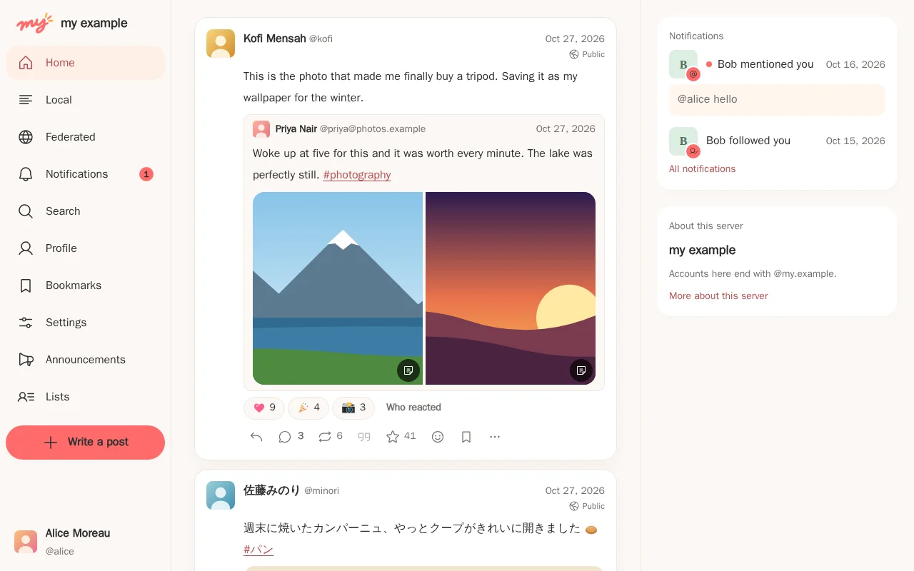

  

<h1 align="center">mycroblog</h1>

  <strong>mycroblog</strong> — a microblog for the fediverse that starts small and grows with your community.

  <code>my</code>, the mycroblog server, speaks ActivityPub and is written in Go. Start on one small machine or a
  scale-to-zero container with SQLite. When your community grows, move to PostgreSQL, a job queue, a stream broker and
  separate web and worker processes: same code, same data.

  
  
  
  

<h3 align="center">
  <a href="https://mycroblog.dev/latest/">Read the documentation at mycroblog.dev</a>
</h3>

  <picture>
    <source media="(prefers-color-scheme: dark)" srcset="app/docs/src/assets/screenshots/home-dark.webp">
    
  </picture>

## Features

<table>
  <tr>
    <td width="50%" valign="top">
      <strong>Start small, scale out</strong> 
      One binary and SQLite on a $5 VM, or a container that scales to zero. Grow into PostgreSQL, Cloud Tasks, Valkey,
      Pub/Sub or SNS, S3 or GCS behind a CDN, and as many web and worker processes as you need.
    </td>
    <td width="50%" valign="top">
      <strong>Federates</strong> 
      Follows, posts, quote posts and custom emoji reactions travel to and from Mastodon, Misskey, GoToSocial and more.
      The "This server" visibility keeps a post within your server and your followers.
    </td>
  </tr>
  <tr>
    <td width="50%" valign="top">
      <strong>Supporters and open books</strong> 
      Paid plans through Stripe or PAY.JP that grant roles, badges and the right to add custom emoji. Record what the
      server costs, import AWS and Google Cloud bills automatically, and publish costs and income to your community.
    </td>
    <td width="50%" valign="top">
      <strong>Voice rooms</strong> 
      Live audio rooms for the people of your server, with hosts, speakers, invitations and reactions. Peer to peer for
      small rooms, LiveKit or Sora for large ones.
    </td>
  </tr>
  <tr>
    <td width="50%" valign="top">
      <strong>A web app for everyone</strong> 
      An installable web app with push notifications and passkeys, translated from day one.
    </td>
    <td width="50%" valign="top">
      <strong>Moderation built in</strong> 
      Reports with appeals, domain blocks, an audit log, and decision hooks that let your own program review posts and
      sign-ups before they are accepted.
    </td>
  </tr>
  <tr>
    <td width="50%" valign="top">
      <strong>Extend it</strong> 
      Plugins over a versioned protocol, server webhooks, OAuth apps, and client and bot libraries for Go and TypeScript.
      Translation of posts runs through a plugin of your choice.
    </td>
    <td width="50%" valign="top"></td>
  </tr>
</table>

## Documentation

The documentation lives at **[mycroblog.dev](https://mycroblog.dev/latest/)**, one version per release (`/latest/` for
the newest, `/v0.1/` and the like) and `/next/` for the development version.

- **Run a server**: [the overview of a mycroblog server](https://mycroblog.dev/latest/operations/overview/),
  [running the server](https://mycroblog.dev/latest/operations/running/),
  [deploying with Docker Compose](https://mycroblog.dev/latest/operations/deploy-docker-compose/),
  [deploying on Cloud Run](https://mycroblog.dev/latest/operations/deploy-cloud-run/), and the
  [production checklist](https://mycroblog.dev/latest/operations/production-checklist/)
- **Use mycroblog**: [signing up and signing in](https://mycroblog.dev/latest/guide/signing-in/),
  [posting](https://mycroblog.dev/latest/guide/posting/), [following people](https://mycroblog.dev/latest/guide/following/),
  and [voice chat](https://mycroblog.dev/latest/guide/voice-chat/)
- **Build on mycroblog**: [the client API](https://mycroblog.dev/latest/developers/client-api/), the
  [API reference](https://mycroblog.dev/latest/api/), and the [client libraries](https://mycroblog.dev/latest/developers/libraries/)
- **Reference**: the [configuration reference](https://mycroblog.dev/latest/reference/configuration/)

> **Status: in development, before the first release (v0).** Data may not survive an upgrade before `v0.1.0`: the
> database may have to be recreated. From `v0.1.0` on, every upgrade between releases keeps your data.

## Contributing

To work on mycroblog, read [CONTRIBUTING.md](CONTRIBUTING.md).

## License

[GNU Affero General Public License v3.0](LICENSE), with one exception: the following are under the MIT License, so
that anyone can use the client API specification and the client libraries generated from it without the AGPL's
conditions.

- `api/spec/` and its bundle `api/openapi.yaml`
- `pkg/mykit/` (the API client library)
- `pkg/mybot/` (the bot library)

`api/plugin/`, the definitions of the plugin protocol, is under the MIT License too. A plugin runs as a separate process
and talks to the server only through that protocol, so the AGPL does not extend to it, and it may have any license.

Everything else (the server, the web client, and the code they generate from `api/spec/` and `api/plugin/`) is
AGPL-3.0-only.
