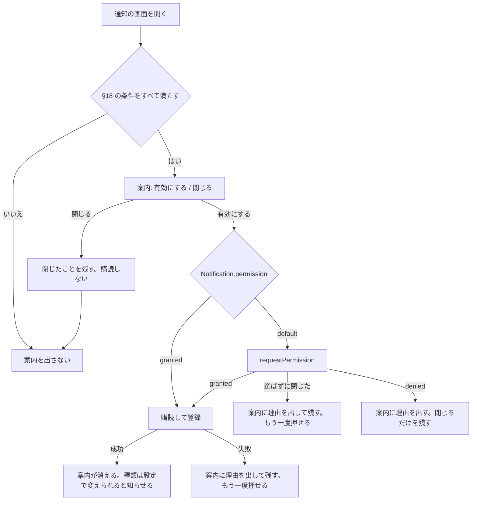

# ADR-0086: メールと通知

- Status: Accepted
- Date: 2026-10-23
- Deciders: @rosylilly
- Issue: #1025, #1624, #1867, #1990

## Decision（決定）

メールはすべて ID だけを積むジョブで送り、秘密はハンドラが発行する。本文は MJML から作る HTML とテキストの両方を持つ。通知は、種類ごとにアプリ内・Web Push・メール・音を 1 つの表で選ぶ。§1〜§7 がメール、§8〜§13 が通知の経路と設定、§14〜§17 が投稿の通知、§18〜§22 が通知の画面の Web Push の案内である。

### 1. 送信はすべてジョブで行う

確認・リセットのリンクの秘密を、ジョブのペイロード（SQS・Cloud Tasks ではクラウドに置かれる）・`dead_jobs`・ログに残さない（ADR-0019、ADR-0004 §6）。SMTP の遅延・障害をリクエストから切り離し、再送を持つ（ADR-0003・ADR-0004）。

- リクエスト・ユースケースは `Mailer.Send` を直接呼ばない。メールを送る事実と同じトランザクションで、outbox に用途ごとのジョブを積む（ADR-0004）。
  `Mailer` を呼ぶのはジョブのハンドラだけにする
- **ペイロードは ID と分類だけ**（利用者・メールアドレス・通知の ID、要求の時刻）。宛先のアドレス・本文・秘密は積まない。ハンドラが実行時に、宛先・ロケール・サーバー名を引いて組み立てる。
  ADR-0004 の失敗したジョブの画面にペイロードが出ても個人情報・秘密を含まない
- **秘密はハンドラが発行する**。確認・リセットのジョブは、実行のたびに新しいトークンを発行して（`user_tokens` に hash を INSERT）、コミットしてから送る。
  秘密はメールの本文にだけ現れ、ペイロード・DB・ログには残らない。再試行や重複の実行では、別の有効なリンクを持つメールがもう 1 通届きうるが、どちらのリンクも 1 回だけ使え、期限で失効するので害はない
- **実行時の再確認**: ハンドラは送る前に、まだ送る理由があるかを確かめる（アドレスが未確認のまま主たるアドレスか、通知の権限と設定がまだあるか、アドレスが抑止されていないか（§5））。なければ送らずに完了する
- **冪等キー**: ジョブの型と、送る理由になった行の ID（通知の ID、確認の要求の ID）で作る。同じ要求から 2 通のジョブは積まない
- **期限**: 取引のメール（確認・リセット）は要求から一定時間（リセットは 15 分、確認は 1 時間）を過ぎたら、送らずに完了する。古いリセットのメールが遅れて届くのを防ぐ
- **再試行**: ポートのエラーを分ける。
  - `kernel.ErrRecipientRejected`（宛先のアドレスが存在しない: SMTP の `RCPT TO` への 5xx で拡張ステータスが `5.1.x`）。`ErrMailRejected` を包み、§5 の記録の対象になる
  - `kernel.ErrMailRejected`（それ以外の恒久的な拒否: `RCPT TO` / `DATA` へのその他の 5xx、SES v2 の `MessageRejected`（内容が不正））
  - それ以外は一時的な失敗（接続・タイムアウト・4xx、SES の `TooManyRequestsException`・`SendingPausedException`・`MailFromDomainNotVerifiedException` など、運営者が直せば通るもの）
  - 恒久的な拒否と `ErrInvalidMail` は `queue.Fail`、一時的な失敗は `queue.Retry`。再試行の方針は、取引のメールが 6 回（30 秒からの指数、合計およそ 15 分）、通知のメールが既定の方針（10 回、合計およそ 4 時間）
- **エラーの文**: ハンドラが返すエラーには、メールアドレス・トークン・本文を入れない（ADR-0004 §6）。ジョブの型・通知の ID・SMTP の応答コードだけを入れる
- 登録の応答は、送信の成否を返さない（「確認のメールを送りました」と表示し、届かなければ再送を求める）。送信の失敗はジョブのダッシュボード（`/admin/jobs`、ADR-0004）で見る

### 2. 組み立て（テンプレートと外枠）

- すべてのメールを `multipart/alternative` で送り、`text/plain` と `text/html`（どちらも UTF-8）を同じ内容で持つ
- 件名・本文の文は `locales/<locale>/server*.json` の ICU メッセージで持ち、生成した型付きアクセサで整形する（ADR-0009）。日時は Go 側で整形した文字列を引数に渡す。メッセージに HTML を書かない（段落は別のメッセージに分ける）
- **共通の外枠** を `internal/app/kernel` に置く組み立て器（`MailComposer` 相当）が付ける。ユースケースは「分類・宛先・ロケール・件名・段落の列・任意の行動（ボタンの文と URL）」を渡すだけにする:
  - 末尾の署名: サーバーの名前、サーバーの URL、`contact_email`（設定されていれば）、「このメールが届く理由」の 1 文
  - 通知・告知のメールには、設定画面へのリンクと配信停止のリンク（§4）
- **HTML のテンプレートは MJML から作る**:
  - 外枠の MJML（レイアウトは 1 つ。段落・ボタン・署名の差し込み口を持つ）をソースとしてリポジトリに置き、ビルド時に Bun で MJML をコンパイルして Go の `html/template` のファイルを作る。生成したファイルはコミットし（Go が読む生成物、ADR-0081）、`embed` でバイナリに入れる。生成が古くないかは既存の生成物の検査と同じく CI で確かめる
  - 実行時に JavaScript を動かさず、`CGO_ENABLED=0` を保つ。MJML は MIT ライセンスで、使う版は 5.4.1（2026-09-10 公開。2026-10-23 に [GitHub のリポジトリ](https://github.com/mjmlio/mjml) と npm で確認。リポジトリは保守が続いている）。開発時の依存として Bun のワークスペースに入れる
  - 差し込む値はすべて `html/template` の文脈に応じたエスケープを通す。利用者の HTML・Markdown を埋め込まない。URL は `https` のものだけを渡す
  - `<html lang dir>` をロケールから付ける（MJML の `<mjml lang dir>` で出力される）。外部のフォント・画像を読まない（コンパイル時に `fonts: {}` を渡し、システムのフォントの並びを使う）。例外はサーバーのロゴがあるときの 1 枚だけで、外枠の先頭に `logo-mail`（ダークの地では `logo-dark-mail`）を出す（ADR-0059）。明暗は `color-scheme` と `prefers-color-scheme` のスタイルで扱う
  - 2026-10-23 に、MJML 5.4.1 を Bun 1.4.3 でコンパイルし、`{{.X}}` の差し込み口が本文・属性・`<html lang dir>` に残ること、生成物を Go の `html/template` が読み、値をエスケープし `javascript:` の URL を無効化すること、`fonts: {}` で Google Fonts への参照が消えることを手元で確かめた
- テキストの版は同じ入力から Go の `text/template` で作る
- `Mailer` ポートの `MailMessage` に、分類（`transactional` / `notification` / `announcement`）・HTML の本文・`From` の表示名・`Reply-To`・追加のヘッダ（`List-Unsubscribe` 系だけを許す）を足す。アダプタはヘッダの注入を `ValidateMail` で拒否し続ける

### 3. ヘッダ

| ヘッダ | 値 |
| --- | --- |
| `From` | `"<サーバー名>" <mail_from>`（RFC 2047 で符号化。サーバー名がなければ host） |
| `Reply-To` | インスタンス設定 `contact_email`。未設定なら付けない（`mail_from` は `noreply@` を想定） |
| `Message-ID` | `<UUIDv7@mail_from のドメイン>`。SES は自分の `Message-ID` と `Date` で上書きする（2026-10-23 に [SendRawEmail](https://docs.aws.amazon.com/ses/latest/APIReference/API_SendRawEmail.html) で確認）ので、SES では付け替わった値になる |
| `Auto-Submitted` | すべてのメールに `auto-generated`（自動応答のループを防ぐ） |
| `List-Unsubscribe` / `List-Unsubscribe-Post` | 通知（`notification`）と告知（`announcement`）のメールだけ。`<https://{host}/mail/unsubscribe?token=...>` と `List-Unsubscribe=One-Click` |

確認・リセット・パスワードの変更の通知・支払いの失敗は取引のメールで、配信停止の対象にしない（止めると安全や契約に関わる知らせが届かない）。Mastodon も `List-Unsubscribe` 系のヘッダを通知のメールにだけ付ける（[notification_mailer.rb](https://github.com/mastodon/mastodon/blob/131aabcaf1f1f13e0615f8ad2748ab05f966e2c9/app/mailers/notification_mailer.rb#L77-L81)、2026-10-23 に確認）。

### 4. 配信の停止

- 配信停止の区分は、通知の設定のメールの列の行（§9）と 1 対 1 にする（§11）。告知の区分は、そのメールを作るときに設定を足す。ADR-0088 の閉鎖の予告と持ち出しの期限のメールは、見落とすとデータを失うので取引のメールとして送る
- 配信停止の **トークンはメールごとにハンドラが発行する**（`user_tokens` の新しい用途 `email_unsubscribe`、区分を持ち、期限 90 日、hash だけを保存）。秘密の扱いは §1 と同じ
- エンドポイント `/mail/unsubscribe`（authpages、ログイン不要）:
  - `POST`（RFC 8058 のワンクリック。本文 `List-Unsubscribe=One-Click`）: トークンを検証し、その区分の設定を off にして `200` を返す。トークンは期限まで何度使ってもよい（冪等）
  - `GET`: 確認の画面を出し、ボタンで同じ `POST` を送る。リンクを先読みするスキャナーで止まらないよう、`GET` では変更しない
- 設定の変更は通知の設定の更新と同じ経路（現在値、ADR-0020 規約 5）で行い、§13 の表に書く

### 5. バウンス・苦情

届かないアドレス・苦情を受けたアドレスを identity モジュールが記録し、送信を止める。

- **記録の出どころ**
  - すべてのアダプタ: 送信時の宛先の拒否（`ErrRecipientRejected`）。ハンドラがジョブを `Fail` にするのと一緒に、ハードバウンスとして記録する
  - `mail/ses`: SES の通知を SNS の HTTPS の購読で受ける（下記）。`Permanent` のバウンス（`General`・`Suppressed`・`OnAccountSuppressionList` などの副種別）をハードバウンス、苦情を苦情として記録する。`Transient`・`Undetermined` のバウンスは記録しない
  - `mail/smtp`: 送信時の拒否だけを記録する。非同期の DSN・フィードバックループは受けない（受信のメールボックスを持たない）
- **データの形**（ADR-0020。identity が所有し、`schema/<dialect>/01-identity.sql` に置く）

  | 表 | 分類 | 列 |
  | --- | --- | --- |
  | `email_delivery_failures` | イベント | `id`・`email_address_id`・種類（`hard_bounce` / `complaint`）・出どころ（`rejection` / `ses`）・`feedback_key`（一意。SES の `feedbackId`、送信時の拒否はジョブの ID と試行）・拡張ステータス（`5.1.1` など、任意）・`occurred_at` |
  | `email_suppression_lifts` | イベント | `id`・`email_address_id`・理由（`reverified` / `moderator`）・`lifted_at` |
  | `email_suppressions` | 投影 | `email_address_id`（主キー）・種類・起点の失敗の ID。最後の解除より後の失敗から導く。再構築のコマンドを持つ |

  - イベントにはアドレスの文字列を持たず、`user_email_addresses` を参照する（ADR-0020 規約 6）。SES の通知のアドレスは正規化して `user_email_addresses` と照合し、一致しなければ何も記録しない
  - `feedback_key` の一意制約で、同じ通知を何度受けても 1 行になる（SNS の再送・ジョブの重複に強い）
- **送信への効き方**（§1 の実行時の再確認で判定する）
  - ハードバウンス: そのアドレスへのすべてのメールを送らない。ただし利用者が自分で求めた確認のメールの再送は送り、確認が済んだら解除のイベント（`reverified`）を記録する。パスワードのリセットは送らず、管理者が発行するリンク（FR-002）で代える
  - 苦情: 通知と告知のメールを送らない。取引のメールは送る
  - モデレーターは管理画面のアカウントの詳細で抑止の状態を見て、解除（`moderator`）できる。利用者は設定画面で、アドレスに届いていないことを見る
- **SES の通知の受け口**（M6、`mail/ses` と一緒に作る）
  - `POST /mail/events/ses`（interface 層の新しいパッケージ。決済の Webhook（ADR-0074 §3）と同じく、クライアント API ではない）。設定 `mail_ses_sns_topic_arn` があるときだけ開き、ないときは `404`
  - SES の構成セットのイベントの送り先（SNS）か、アイデンティティの通知のどちらからでも受ける（本文の `eventType` / `notificationType` の両方を読む。2026-10-23 に [SES の通知の内容](https://docs.aws.amazon.com/ses/latest/dg/notification-contents.html) で確認）
  - **署名の検証**: 処理の前に必ず検証する。`TopicArn` が設定と一致しないものは拒否する。`SignatureVersion` は `2`（SHA256withRSA）だけを受け付け、運営者はトピックの属性 `SignatureVersion` を `2` にする（既定は `1`）。
    署名の証明書は、`SigningCertURL` が `https` で、ホストが `TopicArn` のリージョンの `sns.<region>.amazonaws.com` のときだけ取得し、KV にキャッシュする。
    署名する文字列は種類ごとに決まった項目を名前の順に並べる（2026-10-23 に [SNS の署名の検証](https://docs.aws.amazon.com/sns/latest/dg/sns-verify-signature-of-message.html)・[例のコード](https://docs.aws.amazon.com/sns/latest/dg/sns-example-code-endpoint-java-servlet.html)・[SHA256 の告知](https://aws.amazon.com/about-aws/whats-new/2022/09/amazon-sns-supports-message-signatures-based-sha256-hashing) で確認）
  - 証明書の取得と購読の確認（`SubscriptionConfirmation` の `SubscribeURL` への `GET`。ホストの条件は証明書と同じ）は、SSRF を防ぐ `kernel.HTTPClient` を通す。トランザクションの外で行う
  - 通知は検証のあと、1 つの短いトランザクションでイベントを INSERT し、投影を同期で更新する（ADR-0020 規約 7）。本文の上限を先に掛ける
  - SES の通知は 1 通に複数の宛先を含みうる。サーバーは 1 通に 1 宛先で送るので、苦情の宛先は特定できる（2026-10-23 に SES の通知の内容の文書で確認）

### 6. `mail/ses`

- **M6** で SES v2 の API（`sesv2.SendEmail`、Raw content）で作る。認証は SDK の既定の資格情報の連鎖（IAM ロール）で、SMTP のパスワードを持たない。設定はリージョン・任意の構成セット（configuration set）・§5 の `mail_ses_sns_topic_arn`
- **M5** の間は、SES を使う運営者は SES の SMTP インタフェース（STARTTLS、587）を `mail = smtp` で使う。運用文書に例を載せる。この構成では送信時の拒否だけを記録する
- `mail/ses` は `testkit.MailerContract` を通す。恒久的な拒否を `ErrMailRejected` に写す
- SES は SMTPUTF8 に対応せず、アドレスは 7 ビットの ASCII（ドメインは Punycode）、`From` の表示名は MIME の encoded-word で書く（2026-10-23 に [SendRawEmail](https://docs.aws.amazon.com/ses/latest/APIReference/API_SendRawEmail.html) で確認）。`mail/smtp` と同じ組み立てで満たす
- SES のアカウントの抑止リスト（2019-11-25 以降のアカウントで既定で有効）に載ったアドレスへの送信は、受け付けたうえで送られず、同期のエラーにならない。その送信は `OnAccountSuppressionList` のバウンスとして SNS で届き、§5 で記録する。Gmail は苦情を SES に返さない（2026-10-23 に [SES の抑止リストの文書](https://docs.aws.amazon.com/ses/latest/dg/sending-email-suppression-list.html) で確認）

### 7. 運用文書

`docs/operations/email.md` を足す: 事業者ごとの設定例（SES の SMTP・SES の API、一般的な SMTP の提出）、`mail_from` のドメインの SPF・DKIM・DMARC（`p=none` から始めて整合を確かめる）、SES の SNS トピックと購読の作り方（`SignatureVersion` を `2` にする）、送信の失敗の見方（`/admin/jobs` のメールのジョブの型で絞る、ADR-0004）と抑止の見方・解除、開発環境の Mailpit（#1026）。

### 8. 通知の設定の画面

- 設定の中に「通知」（`/settings/notifications`）を置く。`/settings/preferences` の Web Push の節と `email_moderator_notifications` の項目はこの画面に移す。
- 画面の中心は表で、行が通知の種類のグループ（§9）、列が経路（アプリ内・Web Push・メール・音）。各セルはチェックボックス。
  - Web Push の列は、サーバーが Web Push を送り、この端末で使えるときだけ出す。この端末で受け取るかのスイッチは、今の Web Push の節と同じく表の上に置く。
  - メールの列は、サーバーがメールを送る（`Instance.sends_email`）ときだけ出す。主のアドレスにメールが届かない（`email_suppression`）ときは、列の上にその理由を出す。
  - 止められない経路のセルは、オンのまま操作できないものとして出す（§9 の「固定」）。
- アプリ内がオフの行では、Web Push・メール・音のセルを操作できないものとして出す（§10）。

### 9. 通知の種類のグループと既定

行は今の Web Push のグループを引き継ぎ、次の 3 つに分ける。モデレーター向けは、その種類を受け取る権限を持つ人にだけ出す。サポーターの行は、サポーターの機能を出すクライアントにだけ出す（ADR-0072 §14）。

| 区分 | 行 | アプリ内 | Web Push | メール |
| --- | --- | --- | --- | --- |
| 普段の通知（ほかの利用者の行動） | `mention`、`follow`、`follow_request`、`follow_accepted`、`boost`、`favourite`、`reaction`、`quote`、`poll_closed`、`account_moved`、通話（`voice_room_started`・`voice_room_invited`）、新しい投稿（`status`、§14〜§17） | 選べる・既定オン | 選べる | 選べる・既定オフ（`status` のメールは送らない。§16） |
| モデレーター向け | `admin_report`、`admin_sign_up`、`admin_appeal`、`admin_webhook_disabled`、`admin_custom_emoji_request`、`admin_account_moved`、`admin_service_closure_due`、`admin_error_group`（種類ごとに 1 行） | 選べる・既定オン | 選べる | 選べる・既定オン |
| インスタンスから利用者への知らせ | モデレーション（`moderation_notice`・`report_resolved`・`appeal_decided`・`relationships_severed`・`custom_emoji_request_decided`）、`service_closure`、サポーター（`supporter_*`） | 固定（オン） | 選べる | `service_closure`・サポーターは固定（オン）、モデレーションは選べる・既定オフ |
| インスタンスから利用者への知らせ | お知らせ（`announcement`、ADR-0125） | 選べる・既定オン | 選べる | 送らない（セルを出さない） |

- Web Push の既定は今と同じ（購読を作るときにクライアントが選ぶ）。
- 音は端末ごとの設定（§12）で、既定はすべてオフ。
- 新しい通知の種類を足すときは、この表のどの区分の、どの行に入れるかを決める。

### 10. アプリ内をオフにした種類

- アプリ内の通知は種類で絞れる。相手では絞らない。
- アプリ内をオフにした種類の通知は作らない。作らないので、Web Push・メール・音のどれでも届かない。オフにする前の通知は消さない。
- モデレーター向けの種類をオフにしても、管理画面の未対応の件数（FR-712）は変わらない。件数は通知ではなく、通報や申請の状態から数える。
- インスタンスから利用者への知らせは、`announcement` を除き、アプリ内で止められない。

### 11. 通知のメール

- 普段の通知とモデレーションの知らせのメールは、通知を作ってから **15 分後** に、次をすべて満たすときだけ 1 通ずつ送る。15 分は固定で、設定にしない。
  - 通知が未読のまま（既読の位置 `notifications_marker` より新しく、消していない）
  - 通知がまだ利用者に見える（Web Push の `stillShown` と同じ確認）
  - 利用者の設定で、その行のメールがまだオン
- モデレーター向けのメールは、今と同じく通知の作成と同じトランザクションでジョブを積み、すぐ送る。見落としを防ぐため、未読を待たない。
- 送り先は主のアドレス。確認していないアドレスと、届かなくなったアドレス（§5）には送らない。
- 配信の停止（§4）の区分は、メールの列の行と 1 対 1 にする。ワンクリックの配信停止は、そのメールの行のメールの設定をオフにする。設定は §13 の表に持つ。
- `service_closure`・サポーターのメールは、今と同じく取引のメールとして必ず送り、配信停止のリンクを付けない。アカウントのメール（確認・パスワード）も変えない。

### 12. 通知音

- Web クライアント（と Tauri のアプリ）は、開いている間に新しい通知をリアルタイム更新（FR-207）で受けたとき、その種類の行の音がオンなら音を 1 回鳴らす。音は組み込みの 1 種類で、選べない。
- 設定は端末ごとに、ブラウザの保存領域に持つ（サーバーには送らない）。表の音の列に加えて、全体を止めるスイッチを置く。既定はオフ。
- ブラウザが自動の再生を止めているときは鳴らさない。設定の画面に試しに鳴らすボタンを置き、そこで再生を許してもらう。
- 短い間に続けて届いたときは、まとめて 1 回だけ鳴らす。Web Push の通知の音は OS に任せる。

### 13. 通知の設定の持ち方と API

- アプリ内とメールの設定は利用者ごとにサーバーに持つ。区分 `current-value` の表で、行は（利用者、種類、経路）。既定と違う値だけを持つかどうかは data-model に書くときに決める。
- `email_moderator_notifications` はこの表に置き換えて、なくす（v0.1.0 の前なので、ADR-0023 によりデータは移さない）。
- Web Push の設定は今の購読の `alerts` のまま（端末ごと）。
- クライアント API で、自分の設定を読んで変える。種類の一覧は、その利用者に出す行（権限とサポーターの機能による）を返し、クライアントはそれで表を作る。

### 14. 投稿の通知の購読

- `notification` が購読の表（現在値。行は（購読する利用者、対象のアカウント）と作った時刻）を持つ。表の細部は data-model §4.7 に書く。
- 購読できる相手:
  - ローカルのアカウント: フォローの有無を問わない。自分自身は購読できない。
  - リモートのアカウント: 承認済み（`active`）でフォローしている間だけ。承認待ちのフォローの相手も購読できない。購読は `graph` の公開 API（`Follows`）で確かめる。
  - どちらかがブロックしている相手は購読できない（`422`）。
- リモートの相手へのフォローが終わったら（`graph.follow_terminated`。理由を問わない）、その購読を消す。ローカルの相手は、フォローを解除しても購読を残す。
- ブロックが始まったら（`graph.blocked`。どちら向きも）、その組の購読を消す。
- 購読は相手に知らせず、相手からは見えない（API・ActivityPub のどれにも出さない）。
- 上限は 1 人あたり 1,000 件。超える購読は `422`。
- フォローの設定 `follow_preferences.notify` はなくし、購読の表に置き換える（v0.1.0 の前なので、ADR-0023 によりデータは移さない）。
  クライアント API の `notify`（`FollowAccountRequest` と `Relationship`）は残し、購読の有無を読み書きする。フォローと同時の `notify: true` は、リモートの相手ではフォローが承認されたときに購読を作る（承認待ちの間は `Relationship.notify` が `false`）。
  CSV の `Notify on new posts` の列も購読を読み書きする。

### 15. 通知する投稿

- 対象のアカウントの新しい投稿で、次をすべて満たすもの:
  - このサーバーで作られた投稿か、リモートから `Create` が配送されて届いた投稿。取りに行った投稿（会話・検索・引用のための取得）は、古い投稿を新しい通知にしないよう通知しない
  - 返信でない投稿か、自分自身への返信（スレッドの続き）。他人への返信は通知しない
  - ブーストではない
  - 受け取る人がその投稿を見られる（単一の公開範囲のポリシー関数。`private` は受け取る人がフォロワーのとき、`direct` は宛先のとき）
- 編集（新しい版）は通知しない。
- 受け取る人が宛先のメンションの通知（`mention`）を同じ投稿で受け取るときは、`status` を作らない。
- ブロック・ミュート（`hide_notifications`）・ドメインのミュート・差出人の `unsolicited_reach`（受け取る人がフォローしていないとき）の除外は、ほかの通知と同じに効く（data-model §4.7）。
- 作り方: 投稿を記録したトランザクション（ローカルの作成と、配送された `Create` の取り込み）で積むジョブ（`notification.post_subscribers`、冪等キーは投稿）が、購読者を 100 件ずつ通知する。`dedupe_key` は `status:<status_id>` で、投稿と受け取る人ごとに 1 つ。
- 投稿が消えたら、その通知は読み取り時に隠す（既存の `notification_deleted_statuses`）。

### 16. 投稿の通知の種類と経路

- 通知の種類 `status` を足す。§9 の表では「普段の通知」の区分に 1 行として入れる。
- アプリ内は選べる・既定オン、Web Push は選べる（購読の `alerts` に `status` を足す。既定はほかの普段の通知と同じ）。
- メールでは送らない。通知の設定の表で、この行のメールのセルは出さない。§11 の未読のメールの対象からも外す。
- 音は §12 のとおり端末ごとに選べる。
- Web Push は投稿の画面を開く。

### 17. 投稿の通知の画面

- プロフィールの見出しの操作に、購読を切り替えるボタン（ベルの形）を置く。リモートでフォローしていない相手には押せない状態で出し、「フォローすると新しい投稿を通知できます」と説明する。
- 通知の一覧の種類の絞り込み（§10）に `status` を足す。

### 18. Web Push の案内を出す条件

`/notifications` の上（絞り込みのタブの上）に、次をすべて満たすときだけ出す。`xl` 以上の右帯の通知には出さない。

| 条件 | 満たさないときの理由 |
| --- | --- |
| ログインしている | 購読はログインに属する |
| サーバーが Web Push を送る（`push_server_key`） | 有効にできない |
| ブラウザに Push API と Service Worker がある | 同上。理由は設定の画面に出す |
| サイトの通知をブロックしていない（`Notification.permission` が `denied` でない） | ボタンを押しても何も起きないため。理由は設定の画面に出す |
| この系列の購読がないと分かっている | 読み込み中と取得の失敗では出さない（オンの人に一瞬出さない） |
| 通知の設定の行を読み込めた | 登録する種類（§20）を決められない |
| このブラウザでこのアカウントが案内を閉じていない（§21） | 断った人に出さない |

### 19. Web Push の案内の流れ

- 許可の確認は、「有効にする」を押したときにだけ出す。画面を開いただけでは出さない。MDN も利用者の操作に応じて求めるよう勧め、操作なしの要求は Firefox（72 から）と Safari が許していない（2026-11-03 に [Using the Notifications API](https://developer.mozilla.org/en-US/docs/Web/API/Notifications_API/Using_the_Notifications_API) で確認）。
- 確認を選ばずに閉じたときの `requestPermission()` の結果は `default` である前提で、MDN はこの動作を明記していないので要検証。今の設定のスイッチと同じ処理で、`granted` 以外を「許可されなかった」として扱うので、結果の値によらず購読はしない。
- ブロックされた場合は、`denied` になっても案内をその場で消さず、理由を見せる。次に画面を開いたときは §18 で出ない。
- 案内の文には、設定の「通知」からいつでもオンにできることを書く。「閉じる」に確認のダイアログは出さない。閉じたらフォーカスを絞り込みのタブに移し、フォーカスを失わせない。
- 案内はページ内の区画で、モーダルにしない。通知の一覧の操作を妨げない。

### 20. 案内から登録する種類

設定のスイッチと同じく、通知の設定の行のすべての種類を登録する。購読の処理は `usePushNotifications` を共有し、新しい API を作らない。

ログインし直しの前に種類を絞っていても、元の選択には戻らない。古い購読は配信のときに消え、残っている保証がないため。

### 21. 案内を閉じたことの持ち方

プッシュは端末ごとの設定なので、閉じたことも端末ごとに持つ。

- `lib/storage` に、閉じたアカウント ID の一覧のキーを localStorage に宣言する（web-client の S11）。サーバーには送らない。
- ログアウトしても消さない（`userData: false`）。ログインし直すたびに、断った人へ案内を出さないため。
- アカウントごとに持つので、共有のブラウザで別の利用者がログインすると、その利用者には案内が出る。
- 記録の変わり方は次のとおり。設定で案内の状態が矛盾しないようにする。

| 操作 | 閉じた記録 |
| --- | --- |
| 案内を閉じる | 残す |
| 設定のスイッチをオフにする | 残す（自分で止めた人に案内を出さない） |
| 案内かスイッチで有効にする | 消す（のちにログインし直して止まったとき、案内が出るように） |

ブラウザのデータを消すと記録も消え、案内がまた出る。

### 22. ログインし直しの扱い

自動では登録し直さない。プッシュを使っていた人がログインし直すと、購読がないので次に通知の画面を開いたときに案内が出る。これで #1990 の「知らせなしに止まる」を解消する。

**覆る条件**: 種類の選択を失うことが問題になるなら、古い購読の種類を引き継ぐ方法を別に決める。

### 見直す条件

- 主要なメールクライアントで MJML の出力の表示が崩れる（RTL・ダークモード）と分かり、外枠の修正で直らなければ、HTML の作り方を見直す
- SMTP だけの構成で、非同期のバウンスを受けないことが送信の評判を損なうと分かったら、DSN の受信（受信のメールボックスか、事業者ごとの Webhook）を足す
- 秘密をハンドラで発行すると、ジョブの実行が遅れる環境（Cloud Tasks の遅延など）でリンクの期限の扱いが不自然になると分かったら、Sealer で封じたペイロードを再検討する
- 普段の通知のメールが多すぎるという声が目立つ場合は、まとめて送る方式を検討する
- 特定の相手からの通知が問題になる場合は、相手による絞り込みを別の ADR で検討する
- フォローしていないリモートの購読の要望が強いとき（outbox を定期的に取りに行く方式を別の ADR で検討する）
- 購読者の多い人の投稿で、通知のジョブが詰まるとき

## 経緯

メールは当初プレーンテキストで、確認・リセット・パスワードの知らせはリクエストの中で同期に送っていた。SMTP の遅延が登録を遅らせ、再送がなく、恒久的な拒否と一時的な失敗も区別しなかった。共通の外枠・`List-Unsubscribe`・バウンスの扱いもなく、配信を止めるにはログインが要った（#1025）。

送信者要件は次のとおり。Gmail はすべての送信者に SPF か DKIM を、1 日 5,000 通を超えて Gmail に送る送信者に SPF・DKIM・DMARC（`From` のドメインとの整合）と、マーケティング・購読したメールのワンクリック配信停止と本文の配信停止のリンクを求める。Yahoo も同様で、DMARC は `p=none` 以上、配信停止は 2 日以内に反映する。どちらも取引のメールは配信停止を求める対象に挙げていない（2026-10-23 に [Gmail](https://support.google.com/a/answer/81126)・[Yahoo](https://senders.yahooinc.com/best-practices/) で確認）。

通知の設定は経路ごとに散らばり、アプリ内は絞れず、音はなかった。決定者は、通報が届いたら管理者にメールで知らせること、音を鳴らすこと、Web Push だけ・メールだけを止めることを求めた（#1624）。これで配信停止の区分は、利用者設定の列から通知の設定の表に移った。

投稿の通知は、値を保存するだけだったフォローの `notify` に意味を持たせる形で決めた（#1867）。決定者はフォローの有無を問わない購読を求めたが、フォローしていないリモートのアカウントの投稿はこのサーバーに届かない（`Create` はフォロワーのいるサーバーへ配送される）ので、通知を約束できず、リモートはフォロー必須とした。

Web Push の購読はトークンの系列に 1 つで、配信のたびに系列が使えるかを確かめ、使えなければ消す。Web クライアントが購読を登録するのは設定のスイッチだけなので、ログインし直すとプッシュが知らせなしに止まる（ADR-0090 §14 で止まるのがすぐになった）。決定者の提案で、通知の画面の案内を足した（#1990）。

## 採らなかった案

- 汎用の送信ジョブ `mail.send` に組み立て済みのメッセージを積む: 送信の処理が 1 か所にまとまる（Mastodon も同じ形）。だが本文とアドレスがペイロードと SQS・Cloud Tasks に残り、秘密を Sealer で封じても `dead_jobs` の保持期間（30 日）残り、ロケールが投入時に固定される
- 同期の送信を残し、失敗のときだけジョブで再送する: すぐ届き、失敗を応答で伝えられる（Misskey はキューを通さない）。だがリクエストが SMTP の遅延に引きずられ、経路が 2 つになり、再送のジョブには結局秘密が要る
- プレーンテキストだけ: 作る量が最小で、表示差がない。だが見た目を整えられず、Mastodon・Misskey より見劣りし、RTL をクライアントに任せる
- 非同期のバウンス・苦情を送信事業者の抑止リストに任せる: 受信の口が要らない。だが SES の抑止リストに載った送信はジョブの上で成功に見え、利用者もモデレーターも届かないことを知らない
- `mail/ses` を作らず SES は SMTP だけで使う: 作るものがない。だが SMTP の資格情報を秘密として管理し、Lambda から毎回接続する
- 通知の設定を `/settings/preferences` の中で整理する: 画面が増えないが、環境設定がさらに長くなり探しにくい
- 経路ごとの節に種類のチェックボックスを並べる: 経路ごとに分かりやすいが、同じ種類の設定が離れ、「メールだけ止めたい」の見通しが悪い
- 普段の通知のメールをまとめて送る、または送らない: まとめると数が減るが間隔とテンプレートが要る。送らないとメールで気づきたい利用者に応えられない
- アプリ内を絞らない、または相手でも絞る: 絞らないのは簡単だが要らない種類を止められない。相手で絞るには判定（フォロー・新しいアカウント）の設計が要る
- Web Push の音も選べるようにする、音を入れない: 前者はブラウザと OS で振る舞いが揃わない。後者は決定者の要望に応えない
- 投稿の通知でフォローの `notify` を生かし、未フォローのローカルだけ別の表に持つ: 既存の表を使え、解除で自然に消える。だが置き場所が 2 つになり、一覧・上限・CSV の扱いが分かれる
- 返信とブーストも通知する: 取りこぼしがない。だが会話の多い人の通知が増えすぎ、Mastodon の利用者の期待とも違う
- 案内を閉じたことをサーバーに残す: ブラウザのデータを消しても残る。だが 1 度閉じるとすべての端末で出なくなり、テーブルと API が増える
- ブラウザの購読が残っていれば自動で登録し直す: 操作なしで止まらない。だが共有のブラウザで、ログインしただけの別の利用者の通知が届く
- ログインの直後にダイアログで聞く: 必ず目に入る。だが別の作業を遮り、断られやすい

## Consequences（影響）

- 良い影響
  - SMTP の障害が登録・リセットのリクエストを遅らせず、失敗は再試行され、ジョブのダッシュボードで見える
  - 秘密がメールの本文にしか現れない。SQS・Cloud Tasks のアダプタでもクラウドに秘密を置かない
  - ヘッダと配信停止で、通知のメールが Gmail・Yahoo の送信者要件に沿う
  - 届かないアドレス・苦情を受けたアドレスへ送り続けず、モデレーターと利用者が状態を見られる
  - 通知の受け取り方が 1 つの画面で分かり、モデレーターは最初から通報などをメールで受け取る
  - ローカルの人は、フォローせずに新しい投稿だけを追える。Mastodon からのフォローの CSV の取り込みで購読も移る
  - ログインし直しで止まったプッシュに通知の画面で気づき、1 回の操作で戻せる
- 悪い影響・トレードオフ
  - 登録の直後に「送れなかった」と利用者に返せない。届かなければ利用者が再送を求める
  - ジョブの重複・再試行で、確認・リセットのメールが 2 通届くことがある（どちらのリンクも有効）
  - 配信停止のトークンの行がメールの数だけ増える（期限で消す）
  - MJML と Bun の生成の手順が 1 つ増え、HTML の表示をメールクライアントごとに試す手間がかかる
  - 抑止の表 3 つと、署名の検証を持つ受信の口が増える。SNS の署名の検証は自前で書く（公開鍵の取得と検証の誤りは偽の苦情で送信を止められる危険になる）
  - SMTP の構成では、送信を受け付けた後に返るバウンスは記録されない
  - 通知を作るたびに利用者の設定を読む。普段の通知のメールは、15 分後のジョブで未読を確かめる
  - モデレーター向けのメールの既定がオンなので、権限を付けた人に最初からメールが届く
  - リモートのアカウントはフォローしないと購読できず、フォローを解除すると購読も消える
  - 購読者の多い投稿は、投稿ごとに購読者の数だけ通知の行ができる（ジョブは 100 件ずつに分けるので、投稿のトランザクションは重くならない）
  - 通知の画面を開かない利用者は、プッシュが止まったことに気づかない。案内を一度閉じていた利用者には、のちに出ない（設定からはオンにできる）
  - ログインし直しのあと、種類の選択がすべてオンに戻る
  - 案内が通知の一覧の開始位置を下げ、通知の画面で通知の設定と購読を読むリクエストが増える
  - アカウント ID がログアウト後もブラウザに残る。ID は秘密ではない
- 案内の対象外: iOS / iPadOS の Safari でホーム画面への追加を勧める案内、ブロックを解除する方法の案内（今の設定の画面の文のまま）

## Open Questions / 要検証

- 要検証: MJML の出力（RTL・ダークモード）が主要なメールクライアント（Gmail・Outlook・Apple Mail）で崩れないか。実際のクライアントでの確認が要る
- 要検証: 許可の確認を選ばずに閉じたときの `requestPermission()` の結果（ブラウザごと）。§19 の動作は結果によらない
