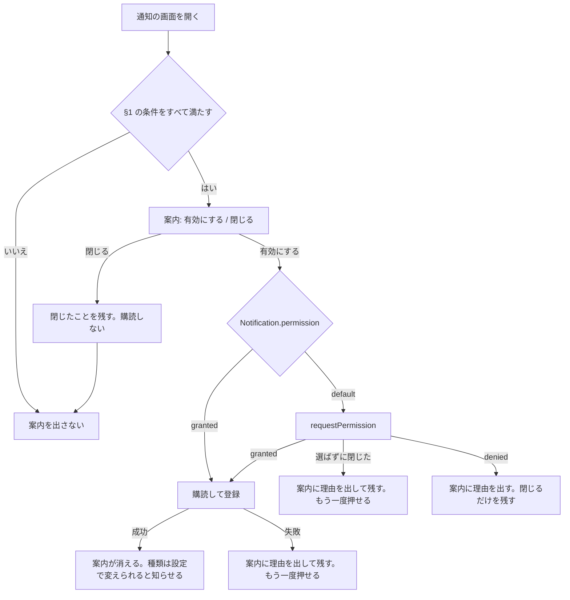

# ADR-0137: 通知の画面の Web Push の案内

- Status: Proposed
- Date: 2026-11-03
- Deciders: @rosylilly
- Issue: #1990

## Context（背景・課題）

Web Push（FR-206）の購読はトークンの系列に 1 つで、配信のたびに系列が使えるかを確かめ、使えなければ購読を消す。
一方、Web クライアントが購読を登録するのは設定の「通知」のスイッチだけ（[ADR-0109](0109-notification-settings.md)）なので、新しい系列には購読がない。

そのため、ログインし直すとプッシュが知らせなしに止まる。[ADR-0136](0136-signed-in-browsers.md) §5 で古い系列をログインし直しの時点で失効させるようになり、止まるのがすぐになった。
また、プッシュの存在に気づく場所が設定の中だけで、初めての利用者にも知らせていない。

決定者の提案（#1990 の議論、原文）:

> ログイン後、WebPush 無効時、通知画面上部に WebPush 有効化の案内とボタンを用意するようにするのがいいのではないでしょうか。閉じるボタンでキャンセルされた場合はそのまま WebPush しないし、案内も消すような。

## Decision Drivers（判断基準）

1. 利用者が操作しない限り、購読も許可の確認も起こさない（共有のブラウザで、別の利用者の通知を届けない）
2. 一度断った人に繰り返し出さない
3. ログインし直しで止まったプッシュに気づける
4. 新しい API と保存データを増やさない

## Considered Options（選択肢）

1. **通知の画面の上の案内。閉じたことはブラウザにアカウントごとに残す**
2. **同じ案内で、閉じたことをサーバーにアカウントごとに残す**
3. **案内を出さず、ブラウザの購読が残っていれば自動で登録し直す**
4. **ログインの直後にダイアログで聞く**

## Decision（決定）

**推奨案: 選択肢 1。** プッシュは端末ごとの設定なので、閉じたことも端末ごとに持つ。選択肢 2 では、PC で閉じるとスマートフォンにも案内が出なくなる。選択肢 3 と 4 を選ばない理由は下の「詳細比較」に書く。

### 1. 案内を出す条件

`/notifications` の上（絞り込みのタブの上）に、次をすべて満たすときだけ出す。`xl` 以上の右帯の通知には出さない。

| 条件 | 満たさないときの理由 |
| --- | --- |
| ログインしている | 購読はログインに属する |
| サーバーが Web Push を送る（`push_server_key`） | 有効にできない |
| ブラウザに Push API と Service Worker がある | 同上。理由は設定の画面に出す |
| サイトの通知をブロックしていない（`Notification.permission` が `denied` でない） | ボタンを押しても何も起きないため。理由は設定の画面に出す |
| この系列の購読がないと分かっている | 読み込み中と取得の失敗では出さない（オンの人に一瞬出さない） |
| 通知の設定の行を読み込めた | 登録する種類（§3）を決められない |
| このブラウザでこのアカウントが案内を閉じていない（§4） | 断った人に出さない |

### 2. 流れ

- 許可の確認は、「有効にする」を押したときにだけ出す。画面を開いただけでは出さない。MDN も利用者の操作に応じて求めるよう勧め、操作なしの要求は Firefox（72 から）と Safari が許していない（2026-11-03 に [Using the Notifications API](https://developer.mozilla.org/en-US/docs/Web/API/Notifications_API/Using_the_Notifications_API) で確認）。
- 確認を選ばずに閉じたときの `requestPermission()` の結果は `default` である前提で、MDN はこの動作を明記していないので要検証。今の設定のスイッチと同じ処理で、`granted` 以外を「許可されなかった」として扱うので、結果の値によらず購読はしない。
- ブロックされた場合は、`denied` になっても案内をその場で消さず、理由を見せる。次に画面を開いたときは §1 で出ない。
- 案内の文には、設定の「通知」からいつでもオンにできることを書く。「閉じる」に確認のダイアログは出さない。閉じたらフォーカスを絞り込みのタブに移し、フォーカスを失わせない。
- 案内はページ内の区画で、モーダルにしない。通知の一覧の操作を妨げない。

### 3. 登録する種類

設定のスイッチと同じく、通知の設定の行のすべての種類を登録する。購読の処理は `usePushNotifications` を共有し、新しい API を作らない。

ログインし直しの前に種類を絞っていても、元の選択には戻らない。古い購読は配信のときに消え、残っている保証がないため。

### 4. 閉じたことの持ち方

- `lib/storage` に、閉じたアカウント ID の一覧のキーを localStorage に宣言する（web-client の S11）。サーバーには送らない。
- ログアウトしても消さない（`userData: false`）。ログインし直すたびに、断った人へ案内を出さないため。
- アカウントごとに持つので、共有のブラウザで別の利用者がログインすると、その利用者には案内が出る。
- 記録の変わり方は次のとおり。設定で案内の状態が矛盾しないようにする。

| 操作 | 閉じた記録 |
| --- | --- |
| 案内を閉じる | 残す |
| 設定のスイッチをオフにする | 残す（自分で止めた人に案内を出さない） |
| 案内かスイッチで有効にする | 消す（のちにログインし直して止まったとき、案内が出るように） |

ブラウザのデータを消すと記録も消え、案内がまた出る。

### 5. ログインし直しの扱い

自動では登録し直さない。プッシュを使っていた人がログインし直すと、購読がないので次に通知の画面を開いたときに案内が出る。これで #1990 の「知らせなしに止まる」を解消する。

**覆る条件**: 種類の選択を失うことが問題になるなら、古い購読の種類を引き継ぐ方法を別に決める。

## Consequences（影響）

- 良い影響
  - ログインし直しで止まったプッシュに、通知の画面で気づいて 1 回の操作で戻せる。
  - 新しい利用者がプッシュを見つけられる。設定に行く必要がない。
  - 共有のブラウザで、別の利用者の通知が届かない。
- 悪い影響・トレードオフ
  - 通知の画面を開かない利用者は、止まったことに気づかない。
  - 案内を一度閉じていた利用者は、のちにプッシュを使っていなければ案内を受けない（設定からはオンにできる）。
  - ログインし直しのあと、種類の選択がすべてオンに戻る。
  - 案内が通知の一覧の開始位置を下げる。
  - アカウント ID がログアウト後もブラウザに残る。ID は秘密ではない。
  - 通知の画面で、通知の設定と購読を読むリクエストが増える。
- 対象外
  - iOS / iPadOS の Safari でホーム画面への追加を勧める案内
  - ブロックを解除する方法の案内（今の設定の画面の文のまま）
- 後続の作業: #1990 で実装し、`screens/notifications.md`、web-client §11 と S11 の表、作業の手順の数を更新する。

## Pros and Cons of the Options（詳細比較・任意）

### 選択肢 2: サーバーに残す

- 良い点: ブラウザのデータを消しても残る。
- 悪い点: 端末ごとの設定なのに、1 度閉じるとすべての端末で出なくなる。テーブルと API が増える。

### 選択肢 3: 自動で登録し直す

- 良い点: 操作なしで止まらない。種類の選択も引き継げる余地がある。
- 悪い点: 共有のブラウザで、ログインしただけの別の利用者の通知が、許可済みのブラウザに届く。同じ利用者に限ると、それを判定する記録が要り、初めての利用者には効かない。

### 選択肢 4: ログインの直後のダイアログ

- 良い点: 必ず目に入る。
- 悪い点: ログインの直後に別の作業を遮る。通知の話をしていない場面で聞くことになり、断られやすい。プッシュが必要な人は通知の画面で十分に気づける。

## Open Questions / 要検証

- 許可の確認を選ばずに閉じたときの `requestPermission()` の結果（ブラウザごと）。実装で確かめ、結果によらず §2 のとおりに動くようにする。
