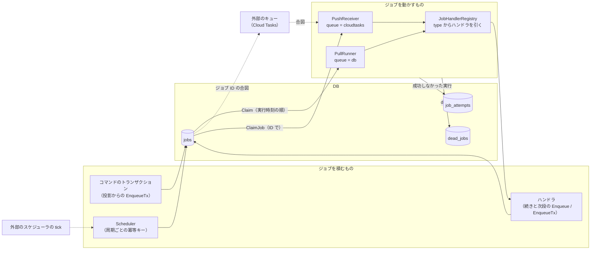
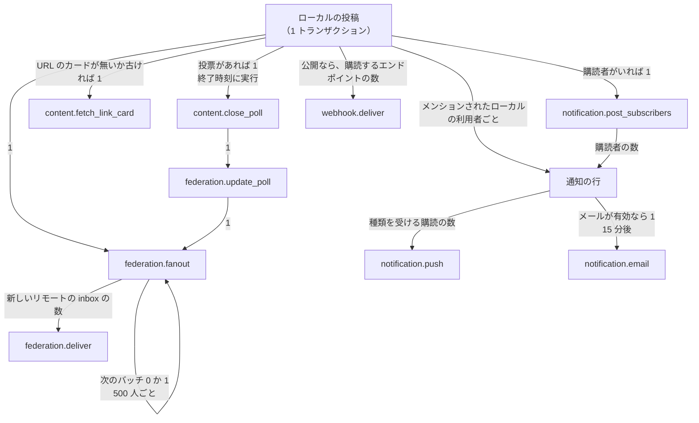
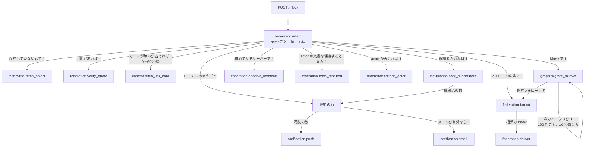
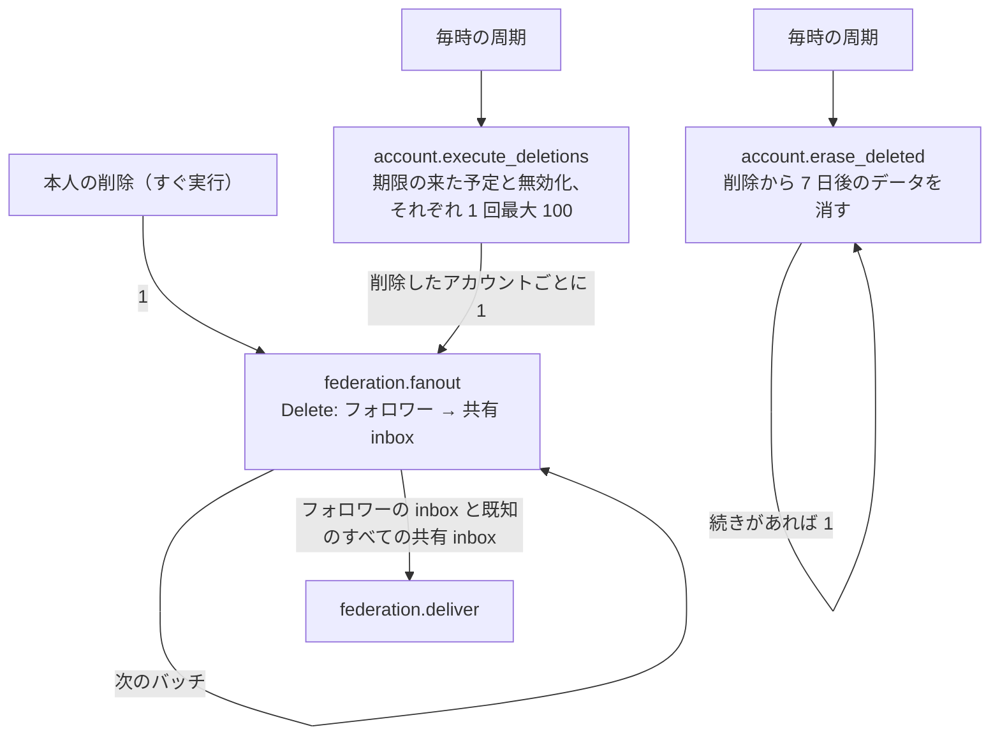

# ジョブの全体像

非同期の処理と定期の処理が、どの部品を通り、1 つの操作からどれだけのジョブに広がるかをまとめます。決定は [ADR-0004](../adr/0004-job-queue-abstraction.md)、種別ごとの役割と定期ジョブの周期は [ジョブのリファレンス](../reference/jobs.md) にあります。

ここに書く数は 2 種類です。**定数**はコードの定数で、確かな値です。**推定**は実際のインスタンスで測っていない見込みで、その旨を書きます。

## 1. 構成

- **積むタイミング**: ドメインの書き込みと同じトランザクションで積むと、コミットしたときだけジョブが存在します。トランザクションの外の `Enqueue` は、続きのページや読み取りの契機で使います。
- **ロール**: `role = all` と `worker` がジョブと `Scheduler` を動かし、`web` は動かしません。合図のキューでは、プロセスはジョブも周期も自分では回さず、要求を受けたときだけ動きます。

## 2. Fan-out

矢印の横に、1 つのジョブや操作から増える数を書きます。

### 2.1 ローカルの投稿

投稿のトランザクションで `content.status_created` の投影が動き、次を同じトランザクションで積みます。添付の `media.process` は、投稿の前のアップロードのときに 1 回積まれます。

- **`federation.fanout`**: 公開の投稿はメンション・フォロワー・リレーの段階を順に進み、1 つのジョブが最大 500 の受信者を読みます。フォロワーの段階のジョブ数は約 `フォロワー数 / 500` です。
- **`federation.deliver`**: 数はフォロワー数ではなく、**フォロワーのいるリモートの inbox の数**です。ローカルのフォロワーと、ドメインブロックや配送不能のサーバーは含みません。リトライは行を増やさず、同じジョブの実行を増やします。
- **`notification.post_subscribers`**: 1,000 人を超えると範囲のジョブに分けます（ADR-0004 §38）。
- **ホームタイムライン**: 配信のジョブはありません（ADR-0013 §1）。

| 例（フォロワーとリモートの inbox の数は推定の例） | `federation.fanout` | `federation.deliver` |
| --- | --- | --- |
| フォロワー 100 人、リモートの inbox 30 | 約 3 | 30 |
| フォロワー 10,000 人、リモートの inbox 1,500 | 約 22 | 1,500 |

同じ流れを通る、ほかの送信:

| 操作 | 段階 | 受信者の規模 |
| --- | --- | --- |
| ブースト | フォロワー、元の投稿者 | 投稿と同じ |
| お気に入り・リアクション、投票 | 投稿者 | 1 |
| フォロー・その応答、ブロック、通報 | 相手、通報先 | 1 |
| 投稿の編集・削除 | 前に送った先。公開と未収載はフォロワー、投票の編集は投票者も | 投稿と同じ |
| プロフィールの変更、移転 | フォロワー | フォロワーの inbox |
| アカウントの凍結と解除、削除 | フォロワー、知っているすべての共有 inbox | **既知のサーバーの数** |

### 2.2 受信したアクティビティ

`POST /inbox` は、検証して記録し、同じトランザクションで `federation.inbox` を 1 つ積みます。同じアクティビティを複数の inbox で受けても 1 つです。

受信は投稿の配送と違い、1 つのジョブから大きくは広がりません。**数は受信の流量そのもの**で、フォローしているリモートのアカウントの投稿数とリレーの有無で決まります。
利用者の操作が起こす取得もあります。スレッドを開くと `federation.fetch_object` が先祖と返信へ広がり、プロフィールを開くと `federation.fetch_outbox` が投稿を取ります。

### 2.3 アカウントの削除と消去

- アカウントの削除では投稿ごとの `Delete` を送らず、actor の `Delete` だけを送ります。
- `Delete` の配送は既知のサーバーの数まで広がります。予定の削除が重なると、1 時間に `100 × 既知の共有 inbox の数` まで増える計算です（理論上の上限で、実際の数は推定できていません）。
- 消去は `account.erase_deleted` の中で閉じ、配送を増やしません。

### 2.4 そのほかの一括の処理

| 契機 | 流れ | 広がり |
| --- | --- | --- |
| お知らせの公開 | `instance.notify_announcement` → 通知 → `notification.push` | ローカルの全利用者（ADR-0004 §38） |
| サービス終了の予告 | `notification.closure_fanout` → 通知 → `notification.push`、`identity.closure_email_fanout` → `identity.closure_email`、`identity.reject_for_closure`、`supporters.cancel_for_closure`、`notification.closure_due` | ローカルの全利用者、確認済みのメールの全利用者 |
| サービス終了の実行 | `instance.closure_delete_actors` → アカウントごとの `federation.fanout` → `federation.deliver` | ローカルの全アカウント × 既知のサーバーの数 |
| 通話の開始 | `voice.notify_started` → 通知 → `notification.push` | ローカルのフォロワー（ADR-0004 §38） |
| 通話の参加者の確認 | `voice.check_account`、`voice.check_block`、`voice.check_hosts` | アカウント・ブロックの変更ごとに 1、ロールの変更で開いている全ルーム |
| イベントの主催者の凍結・削除 | `gathering.cancel_organized` → イベントごとの中止 → `gathering.notify` | 主催者の開始前のイベントの数 |
| 通報・登録の申請など | 通知 → `notification.push`、`notification.moderator_email` | その種類を受け取る権限を持つ人の数 |
| 本人による無効化 | `identity.deactivation_email`、`federation.fanout` → `federation.deliver` | メール 1 通と、`Delete` と同じ宛先への `Update` |
| ドメインの凍結 | `moderation.sever_domain` | ローカルの全アカウントを読む（ADR-0004 §38） |
| インポート | `identity.process_import` → フォローごとの `federation.fanout` → `federation.deliver` | 1 回 20 項目 |
| 投稿の取り直し | `federation.refetch_walk` → `federation.refetch_status` | 100 件ごと |
| サポーターの決済 | `supporters.apply_payment_event` → `supporters.sync`・`supporters.command`、`notification.supporter_email` | 決済の通知ごと |

## 3. 負荷が集中するところ（推定）

実際のインスタンスの計測はありません。次は §2 の広がりからの推定です。

| 順 | 種別 | 理由 |
| --- | --- | --- |
| 1 | `federation.deliver` | 件数が最も多い見込み。投稿ごとにリモートの inbox の数だけ増え、失敗するとリトライが重なる。外部への HTTP で、遅いサーバーの応答を待つ |
| 2 | `federation.inbox` | 受信の流量そのもの。順序キーで actor ごとに直列になる |
| 3 | `notification.push` | 通知 × 購読の数。外部のプッシュサービスへの HTTP |
| 4 | `content.fetch_link_card` | リモートの投稿にも広がる。外部への HTTP で、ホストごとの上限で `Postpone` する |
| 5 | `media.process` | 件数は少ないが 1 件が重い見込み。ほかの種別と分けたくなる候補 |

既定ではワーカーはプロセスごとに 1 度に 1 ジョブなので、遅い `federation.deliver` が続くと、同じプロセスの通知やメールの開始が遅れます。種別で優先する仕組みはなく、ワーカーかキューを種別で分けて対処します（ADR-0004 §15、§23）。

### 確かめ方

実際のインスタンスで、次を見て推定を確かめます。Prometheus では `my.job.duration` は `my_job_duration_seconds` です。

| 知りたいこと | 見るもの |
| --- | --- |
| 種別ごとの件数の比率 | `sum by (my_job_type) (rate(my_job_duration_seconds_count[1h]))` |
| 種別ごとのワーカー時間の比率 | `sum by (my_job_type) (rate(my_job_duration_seconds_sum[1h]))` |
| 必要な同時実行数の目安 | 上の式の合計。1 秒あたりのジョブの実行時間の合計が、同時に動いているジョブの数の平均になる |
| 待たされている種別 | `my.job.wait` の種別ごとの分位数 |
| 溜まっている種別 | `my.queue.ready`、`my.queue.oldest_ready_age`（どちらも種別ごと） |
| 失敗の多い種別 | `my.job.duration` の `my.outcome = retry` |

`my.job.duration` は実行した分だけ増えるので、まだ動いていないジョブは `my.queue.ready` と `my.job.wait` で見ます。
