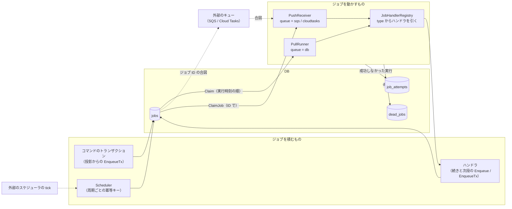
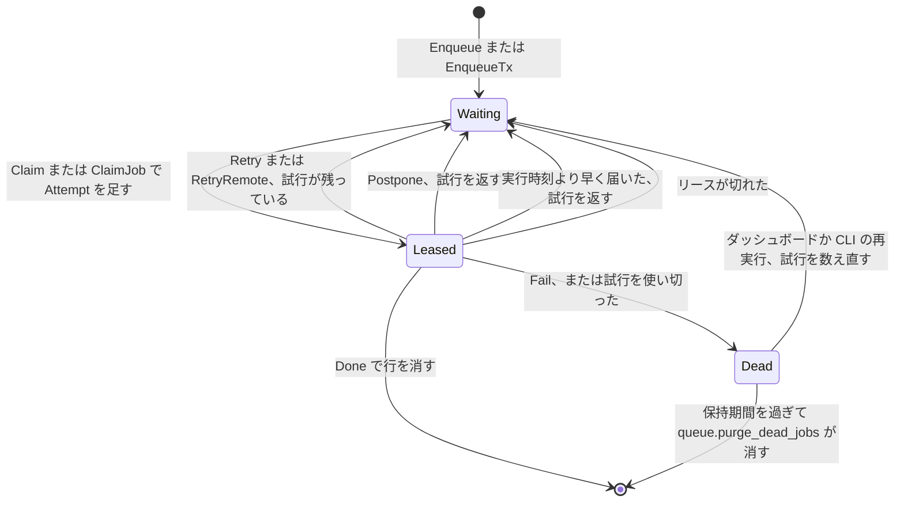
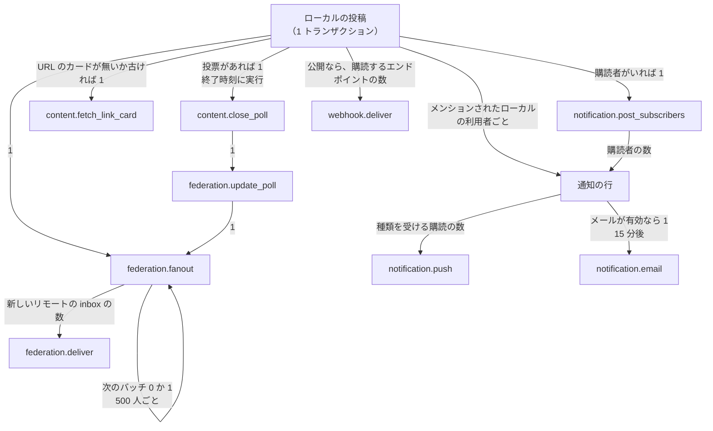
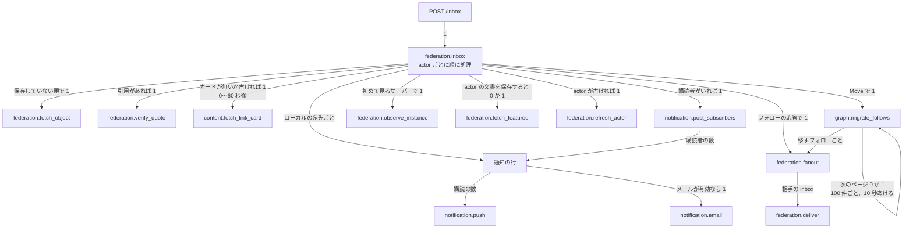
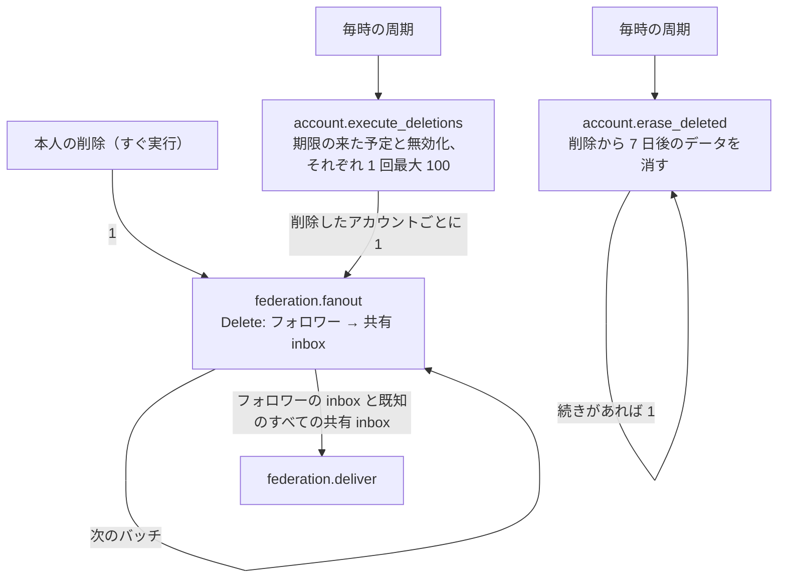
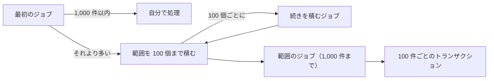

# ジョブの全体像

非同期の処理と定期の処理が、どの部品を通り、1 つの操作からどれだけのジョブに広がるかをまとめます。ポートの一覧は [overview §3](overview.md#3-ポート一覧)、連合の展開と配送の詳細は [連合の設計 §7](federation.md#7-送信配送) です。

種別ごとの役割・積む契機・失敗時の扱いと定期ジョブの周期は [ジョブのリファレンス](../reference/jobs.md) にあります。

ここに書く数は 2 種類です。**定数**はコードの定数で、確かな値です。**推定**は実際のインスタンスで測っていない見込みで、その旨を書きます。

## 1. 構成

- **ジョブの置き場**: `queue = inline`（テストと開発用）を除き、ジョブの本体は `jobs` にあります。SQS と Cloud Tasks は、ジョブ ID と時刻だけの合図を運びます（[ADR-0004](../adr/0004-job-queue-abstraction.md)）。合図は重複しても失っても構いません。`ClaimJob` は 1 回しか取れず、失った合図は `WakeSweeper` が送り直します。
- **積むタイミング**: ドメインの書き込みと同じトランザクションで積むと（`Outbox.EnqueueTx`）、コミットしたときだけジョブが存在します。トランザクションの外の `JobQueue.Enqueue` は、続きのページや読み取りの契機で使います。
- **実行の単位**: `PullRunner` は 1 度に 1 つのジョブを順に動かします（`RunUntil` のループ）。プロセスの並列度は `worker_job_concurrency`（既定 1、[ADR-0004](../adr/0004-job-queue-abstraction.md)）で、2 以上では `SlotRunner` がスロットごとに `PullRunner` を動かします。空いたスロットだけが claim し、ジョブがない間は 1 つのスロットだけがポーリングします。`PushReceiver` の並列度は、プラットフォームが同時に送る要求の数です。
- **ロール**: `role = all` と `worker` がジョブと `Scheduler` を動かし、`web` は動かしません。合図のキューでは、プロセスはジョブも周期も自分では回さず、要求を受けたときだけ動きます。
- **種別の選択**: ワーカーはすべての種別を実行します。`Claim` は実行時刻が最も早いジョブを取り、種別では絞りません。

## 2. ジョブのライフサイクル

- 冪等キーが同じ未完了のジョブがあれば、積みません。
- `Waiting` のジョブは、実行時刻の前と、順序キーで止められている間は取られません。
- ハンドラのない種別は、`ErrNoHandler` の `Retry` として試行を使い切り、dead になります。指標の `my.job.type` は `other` です。

| 項目 | 値（定数） |
| --- | --- |
| リース | 5 分（`DefaultLease`）。ハンドラの `ctx` もリースの終わりで切れる |
| 空のときのポーリング | 1 秒（`DefaultPollInterval`） |
| 既定のリトライ | 10 回、30 秒から倍増、上限 24 時間、ジッタ 20% |
| `federation.deliver` のリトライ | 9 回、1 分・5 分・30 分・2 時間・12 時間・24 時間 ×3（約 4 日） |
| `identity.verification_email`、`identity.password_reset_email` のリトライ | 6 回、30 秒から倍増（約 15 分） |
| `webhook.deliver`、`identity.build_export` のリトライ | それぞれ独自の方針（`webhook.RetryDelays`、`internal/app/identity/export.go`） |
| dead の保持 | 既定 30 日（`DefaultDeadJobRetention`） |

### 順序キー

同じ順序キーのジョブは、先に積まれたジョブが終わるまで取られません。先のジョブがリトライで待っている間も、後のジョブは止まります。

| 順序キー | 種別 | 意味 |
| --- | --- | --- |
| `inbox:<actor の URI>` | `federation.inbox` | 同じ actor の受信を順に処理する |
| `like:<account>:<status>` | `federation.fanout`（Like・Undo） | Like と Undo の順を保つ |
| 上のキー + `:<inbox>` | `federation.deliver`（Like・Undo） | 同じ inbox への順を保ち、ほかの inbox は待たない |
| `voice_room:<room>` | `voice.apply`、`voice.apply_media_event` | 同じルームの操作を順に実行する |
| `supporter_subscription:<id>` | `supporters.sync`、`supporters.command` | 同じ契約を順に処理する |
| `supporter_plan:<plan>` | `supporters.ensure_prices` | 同じプランを順に処理する |
| `payment:<provider>:<object>` | `supporters.apply_payment_event` | 決済の同じオブジェクトを順に処理する |
| `identity.process_import:<import>` | `identity.process_import` | 1 つのインポートのバッチを順に処理する |
| `instance.closure_delete_actors` | `instance.closure_delete_actors` | 続きのページが重ならないようにする |

## 3. Fan-out

矢印の横に、1 つのジョブや操作から増える数を書きます。

### 3.1 ローカルの投稿

投稿のトランザクションで `content.status_created` の投影が動き、次を同じトランザクションで積みます。添付の `media.process` は、投稿の前のアップロードのときに 1 回積まれます。

- **`federation.fanout`**: 公開の投稿はメンション・フォロワー・リレーの段階を順に進み、1 つのジョブが最大 500 の受信者（`FanOutBatch`）を読みます。段階ごとに 1 ジョブ以上で、フォロワーの段階のジョブ数は約 `フォロワー数 / 500` です。
- **`federation.deliver`**: 受信者を共有 inbox にまとめ、`(activity, inbox)` で一意にします。数はフォロワー数ではなく、**フォロワーのいるリモートの inbox の数**です。ローカルのフォロワーと、ドメインブロックや配送不能のサーバーは含みません。リトライは行を増やさず、同じジョブの実行を増やします（最大 9 回）。
- **`notification.post_subscribers`**: 最初のジョブが購読者を数え、1,000 人以内なら自分で 100 人ごとの短いトランザクションで通知します。それより多ければ、同じ種類のジョブを範囲ごとに積みます（[§3.6](#36-広いジョブの分割)）。再実行しても重複しません。
- **ホームタイムライン**: 配信のジョブはありません。

| 例（フォロワーとリモートの inbox の数は推定の例） | `federation.fanout` | `federation.deliver` |
| --- | --- | --- |
| フォロワー 100 人、リモートの inbox 30 | 約 3 | 30 |
| フォロワー 10,000 人、リモートの inbox 1,500 | 約 22 | 1,500 |

同じ流れを通る、ほかの送信:

| 操作 | 段階 | 受信者の規模 |
| --- | --- | --- |
| ブースト | フォロワー、元の投稿者 | 投稿と同じ |
| お気に入り・リアクション、投票 | 投稿者 | 1 |
| フォロー・その応答、ブロック、通報 | 相手、通報先 | 1 |
| 投稿の編集・削除 | 前に送った先。公開と未収載はフォロワー、投票の編集は投票者も | 投稿と同じ |
| プロフィールの変更、移転 | フォロワー | フォロワーの inbox |
| アカウントの凍結と解除、削除 | フォロワー、知っているすべての共有 inbox | **既知のサーバーの数** |

### 3.2 受信したアクティビティ

`POST /inbox` は、検証して記録し、同じトランザクションで `federation.inbox` を 1 つ積みます。冪等キーはアクティビティの URI のハッシュなので、同じアクティビティを複数の inbox で受けても 1 つです。

受信は投稿の配送と違い、1 つのジョブから大きくは広がりません。**数は受信の流量そのもの**で、フォローしているリモートのアカウントの投稿数とリレーの有無で決まります。

利用者の操作が起こす取得もあります。スレッドを開くと `federation.fetch_object` が先祖と返信へ広がり（1 スレッド最大 100 文書 `ThreadMaxItems`、1 時間に 1 回 `ThreadFetchTTL`）、プロフィールを開くと `federation.fetch_outbox` が 1 アカウント 1 日 1 回、最大 20 投稿を取ります。

### 3.3 アカウントの削除と消去

- 本人の削除は同じトランザクションで `Delete` を送り始めます。BAN の予定と、30 日を過ぎた本人の無効化は `account.execute_deletions` が拾います。
- アカウントの削除では投稿ごとの `Delete` を送りません（`ByAccountErasure`）。配送は actor の `Delete` です。
- `Delete` の配送は既知のサーバーの数まで広がります。予定の削除が重なると、1 時間に `100 × 既知の共有 inbox の数` まで増える計算です（理論上の上限で、実際の数は推定できていません）。
- 消去は `account.erase_deleted` の中で閉じ、配送を増やしません。

### 3.4 定期ジョブ

`Scheduler` は時間を枠に分け、`schedule:<name>:<slot>` の冪等キーで積みます。複数のプロセスが動いても、未完了の間は 1 枠に 1 つです。枠の確認は 1 分ごとです。機能が無効のときに登録されないものがあるので、すべてが常に動くわけではありません。

| 周期（定数） | 種別 | 広がり |
| --- | --- | --- |
| 1 分 | `voice.sweep` | |
| 5 分 | `moderation.expire_restrictions`、`supporters.sync_due` | |
| 10 分 | `instance.check_closure_delivery` | |
| 15 分 | `stream.sweep`、`metrics.snapshot` | |
| 1 時間 | `federation.refresh_stale_actors` | 200 件ごとに続き 1、古くてフォロワーのいる actor ごとに `federation.refresh_actor` |
| 1 時間 | `content.purge_remote_statuses`、`content.purge_relayed_statuses`、`content.auto_delete_statuses`、`account.erase_deleted` | 続きがあれば 1 |
| 1 時間 | `account.execute_deletions` | [§3.3](#33-アカウントの削除と消去) |
| 1 時間 | `kv.purge_expired`、`media.purge_unattached`、`media.purge_replaced`、`media.purge_remote_cache`、`graph.expire_mutes`、`moderation.purge_records`、`federation.purge_records`、`webhook.purge_messages`、`queue.purge_dead_jobs`、`voice.purge_records`、`identity.expire_imports`、`identity.expire_exports`、`identity.purge_unused_oauth_clients`、`identity.purge_origins`、`identity.purge_auth_records`、`identity.queue_closure_reminders` | |
| 6 時間（設定で 15 分〜7 日） | `supporters.reconcile_payments` | |
| 1 日 | `federation.probe_instances` | 50 件ごとに続き 1 |
| 1 日 | `account.prune_remote_profiles`、`content.purge_remote_emojis` | 続きがあれば 1 |
| 1 日 | `content.purge_link_cards`、`projection.verify`、`finance.import_billing`、`notification.purge_error_group_notices`、`diagnostics.purge_error_counts`、`supporters.purge_payment_receipts`、`translation.purge_cache` | |

合図のキューの掃除 `queue.wake` はジョブではなく、tick の中で動きます。

### 3.5 そのほかの一括の処理

| 契機 | 流れ | 広がり |
| --- | --- | --- |
| お知らせの公開 | `instance.notify_announcement` → 通知 → `notification.push` | ローカルの全利用者（[§3.6](#36-広いジョブの分割)） |
| サービス終了の予告 | `notification.closure_fanout` → 通知 → `notification.push`、`identity.closure_email_fanout` → `identity.closure_email`、`identity.reject_for_closure`、`supporters.cancel_for_closure`、`notification.closure_due` | ローカルの全利用者、確認済みのメールの全利用者（100 人ごと） |
| サービス終了の実行 | `instance.closure_delete_actors` → アカウントごとの `federation.fanout` → `federation.deliver` | ローカルの全アカウント × 既知のサーバーの数 |
| 通話の開始 | `voice.notify_started` → 通知 → `notification.push` | ローカルのフォロワー（[§3.6](#36-広いジョブの分割)） |
| 通話の参加者の確認 | `voice.check_account`、`voice.check_block`、`voice.check_hosts` | アカウント・ブロックの変更ごとに 1、ロールの変更で開いている全ルーム |
| 通報・登録の申請など | 通知 → `notification.push`、`notification.moderator_email` | その種類を受け取る権限を持つ人の数 |
| パスワードの変更・削除 | `identity.password_notice_email` | 1 |
| 本人による無効化 | `identity.deactivation_email`、`federation.fanout` → `federation.deliver` | メール 1 通と、`Delete` と同じ宛先への `Update` |
| ドメインの凍結 | `moderation.sever_domain` | ローカルの全アカウントを読む（[§3.6](#36-広いジョブの分割)） |
| インポート | `identity.process_import` → フォローごとの `federation.fanout` → `federation.deliver` | 1 回 20 項目 |
| 投稿の取り直し | `federation.refetch_walk` → `federation.refetch_status` | 100 件ごと |
| サポーターの決済 | `supporters.apply_payment_event` → `supporters.sync`・`supporters.command`、`notification.supporter_email` | 決済の通知ごと |

### 3.6 広いジョブの分割

ハンドラの期限はリースの 5 分です。1 つのジョブで全員を回すと、リースが切れたときに先頭からやり直すので、その人数に届かない限り最後まで終わらず、やがて死んだジョブになります。通知の dedupe key は二重の通知を防ぎますが、やり直しの費用は減らしません。

そのため、人数が広がるジョブは `queue.FanOut` で分けます。

- **対象**: `notification.post_subscribers`（最初に `COUNT` で数える）、`instance.notify_announcement`、`notification.closure_fanout`、`identity.closure_email_fanout`、`voice.notify_started`、`moderation.sever_domain`（最初のページで判定する）。種類は増やさず、ペイロードの `cursor` と `range` で区別するので、同じワーカーで動きます。
- **冪等キー**: 最初のジョブの冪等キーに範囲の始まりを足します。最初のジョブのやり直しは、まだ待っている範囲を積みません。すでに終わった範囲は積み直すことがありますが、各ジョブは 2 度処理しても安全です。
- **途中の変更**: 範囲はキーの境界だけを持つので、途中で増えた人はその場所の範囲か、終わりのない最後の範囲で処理します。消えた人は処理せず、範囲が次の範囲に少しはみ出すことはあります。
- **並行**: 範囲のジョブは順序キーを持たないので、[同時実行](../operations/running.md)や複数のワーカーで並びます。
- **1,000 件の根拠**: 手元の WSL2 上の PostgreSQL 18（本番相当ではない）で購読者の通知は 1 人あたり約 3 ms（300 人で 3 回計測。再実行も同じ費用）で、1,000 人で約 3 秒です。リースの 5 分に約 100 倍の余裕があり、DB が遅くなっても 1 ジョブがリース内に収まる見込みです（推定）。また、1,000 件の境界を読むのは 100 回で 5.6 秒（100 万行）、数えるのは 32 ms でした。

`instance.closure_delete_actors` と `identity.reject_for_closure` は対象外です。前者はページごとに続きを積み、後者は処理した登録が待ちの一覧から外れるので、やり直しても進みます。

## 4. 負荷が集中するところ（推定）

実際のインスタンスの計測はありません。次は §3 の広がりからの推定です。

| 順 | 種別 | 理由 |
| --- | --- | --- |
| 1 | `federation.deliver` | 件数が最も多い見込み。投稿ごとにリモートの inbox の数だけ増え、失敗するとリトライが重なる。外部への HTTP で、遅いサーバーの応答を待つ |
| 2 | `federation.inbox` | 受信の流量そのもの。順序キーで actor ごとに直列になる |
| 3 | `notification.push` | 通知 × 購読の数。外部のプッシュサービスへの HTTP |
| 4 | `content.fetch_link_card` | リモートの投稿にも広がる。外部への HTTP で、ホストごとの上限で `Postpone` する |
| 5 | `media.process` | 件数は少ないが 1 件が重い見込み。ほかの種別と分けたくなる候補 |

既定ではワーカーはプロセスごとに 1 度に 1 ジョブなので、遅い `federation.deliver` が続くと、同じプロセスの通知やメールの開始が遅れます。種別で優先する仕組みはなく、ワーカーを種別で分けて対処します。

`queue = db` では、`worker_job_types` と `worker_job_types_except` で種別ごとにワーカーを分けられます（[ADR-0004](../adr/0004-job-queue-abstraction.md)）。分けるときの順序キーの制約は[順序キー](#順序キー)の表のとおりで、同じキーを持つ種別は同じワーカーの組に置きます。外部のキューの構成では分けられません。

`queue = sqs` と `cloudtasks` では、`queue_sqs_routes` と `queue_cloudtasks_routes` で種別ごとに合図のキューを分け、処理能力をプラットフォームの設定で変えられます（[ADR-0004](../adr/0004-job-queue-abstraction.md)）。振り分けるのは合図を送る側（`WakeRouter`）だけで、受け口はどの合図でも同じように `ClaimJob` します。キューが違っても順序キーの判定は DB で行うので、順序は変わりません。掃除（`queue.wake`）はルートごとに 1 回 500 件まで読み、ルートのある種別は `jobs_type_run_at_id` を引きます。

### 確かめ方

実際のインスタンスで、次を見て推定を確かめます。Prometheus では `my.job.duration` は `my_job_duration_seconds` です。

| 知りたいこと | 見るもの |
| --- | --- |
| 種別ごとの件数の比率 | `sum by (my_job_type) (rate(my_job_duration_seconds_count[1h]))` |
| 種別ごとのワーカー時間の比率 | `sum by (my_job_type) (rate(my_job_duration_seconds_sum[1h]))` |
| 必要な同時実行数の目安 | 上の式の合計。1 秒あたりのジョブの実行時間の合計が、同時に動いているジョブの数の平均になる |
| 待たされている種別 | `my.job.wait` の種別ごとの分位数 |
| 溜まっている種別 | `my.queue.ready`、`my.queue.oldest_ready_age`（どちらも種別ごと） |
| 失敗の多い種別 | `my.job.duration` の `my.outcome = retry` |

`my.job.duration` は実行した分だけ増えるので、まだ動いていないジョブは `my.queue.ready` と `my.job.wait` で見ます。
