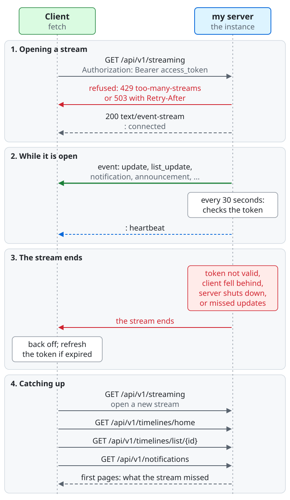

# The event stream

The server pushes new posts, notifications, direct messages, and announcements as [Server-Sent Events](https://html.spec.whatwg.org/multipage/server-sent-events.html) (`text/event-stream`), so a client need not poll.

| Endpoint | Scopes | Events |
| --- | --- | --- |
| `GET /api/v1/streaming` | `read:statuses` and `read:notifications` | The user's home and list timelines, notifications, conversations of the direct messages (with `read:direct`), and announcements. |
| `GET /api/v1/streaming/timelines/{timeline}` | `read:statuses` | New posts (`update` only) of the local or federated timeline. |

Open a stream with `fetch` and the `Authorization: Bearer` header, like any other call. The browser's `EventSource` cannot send the header, so it cannot be used.

From the top of the diagram down, between the client and the server:

1. **Opening a stream.** The client sends `GET /api/v1/streaming` with `Authorization: Bearer <access_token>`. The server
   refuses with `429` (`/api/v1/problems/too-many-streams`) or with `503` and `Retry-After`, or answers `200` with
   `text/event-stream` and the comment line `: connected`.
2. **While it is open.** The server sends events (`update`, `list_update`, `notification`, `announcement`, ...). Every 30
   seconds it checks the access token again and sends the comment line `: heartbeat`.
3. **The stream ends** when the token is no longer valid, the client fell behind, the server shuts down, or the server may
   have missed updates. The client backs off, and refreshes the token if it expired.
4. **Catching up.** The client opens a new stream with `GET /api/v1/streaming`, then reads what the stream missed from the
   first pages of `GET /api/v1/timelines/home`, `GET /api/v1/timelines/list/{id}`, `GET /api/v1/conversations` and `GET /api/v1/notifications`: the server
   replays nothing.

## Events of `/api/v1/streaming`

| Event | `data` |
| --- | --- |
| `update` | A `Status`: a new post or boost in the home timeline, as it would appear there. |
| `list_update` | `{"list_id": "...", "status": {...}}`: the same post, once for each of the user's lists that shows it, right after its `update`. |
| `notification` | A `Notification`. A notification that the user's notification policy filters into a notification request sends none. |
| `conversation` | A `Conversation`, as `GET /api/v1/conversations` shows it: a direct post the user sent or received arrived in it, or the user read it on a device. A token without `read:direct` receives none, and a conversation that the user hid receives none until a newer post arrives. |
| `announcement` | An `Announcement` that was published or changed. |
| `announcement_removed` | `{"id": "..."}`: an announcement no longer shows. |

The user's keyword filters apply to the events as to the timelines and notifications they come from: a post that a filter with the action `hide` matches is never sent, nor is its notification, and a post that only `warn` filters match arrives with them in its `filtered`.

The server sends a comment line (`: heartbeat`) every 30 seconds. Ignore events you do not know: new ones can appear ([stability](stability.md)).

## Staying connected

- **The server replays nothing.** After a stream ends, reconnect and read what you missed with ordinary requests: the first page of the home timeline, of the open list timelines (or of the local or federated timeline for those streams), the conversations, and the notifications. Announcements whose window starts later arrive with no event; list them from time to time.
- The server ends a stream when the access token stops being valid, when the client does not keep up, when the server shuts down, and when it may have missed updates. A timeline stream also ends, and then answers `404`, while the instance turns that timeline off. Reconnect with a backoff, and with a refreshed token if the old one expired.
- `429` with the type `/api/v1/problems/too-many-streams`: the user already holds as many streams open as the server allows. Close one.
- `503` with `Retry-After`: the server cannot receive updates now. Retry after that many seconds.
- Other `4xx` answers (a `401` that a refresh did not cure, a `403` for a missing scope) will not change by retrying: fix the cause.
- A proxy that buffers responses breaks a stream. Where you cannot avoid one, read the notifications and the timelines with ordinary requests instead.
- On an instance that runs several server processes without a shared stream broker, a stream may miss updates. The operator can tell you which your instance uses.

The [client libraries](libraries.md#streaming) implement the reconnecting for you.
