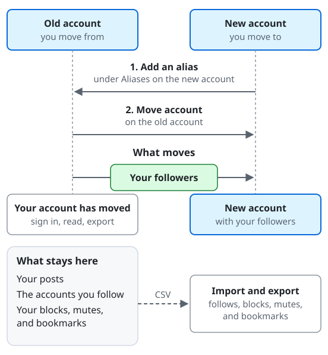

# Moving your account

You can move your account to another account, on the same server or on another one. Your followers follow the new
account, and the old account says that it moved. The same works in the other direction, when you move to this server
from another one.

## What moves and what stays

| Moves | Stays on the old account |
| --- | --- |
| Your followers | Your posts, the accounts you follow, your blocks, mutes, and bookmarks |

From the top of the diagram down:

1. **Add an alias.** On the new account, add the old account under "Aliases".
2. **Move account.** On the old account, choose "Move account" and name the new account.
3. **What moves.** Your followers follow the new account. The old account shows "Your account has moved": you can still sign in, read, and export your data there.
4. **What stays here.** Your posts, the accounts and hashtags you follow, and your blocks, mutes, and bookmarks stay on the old account. Your posts do not move. Carry the rest as CSV files, with "Export" on the old account and "Import" on the new one ([taking your follows with you](#taking-your-follows-with-you)).

## Moving from this account

1. On the new account, add this account as an alias: "Aliases", under "Account and data" in the settings, under "Add an alias". "Move account" shows this account's handle to enter there.
2. On this account, open "Move account" under "Account and data" in the settings, which says what moves and what stays. Under "Account you are moving to", enter the new account's handle (such as `@name@example.com`) or the address of its profile, and choose "Move account".
3. Confirm it's you with your password, a passkey, or a linked provider. A move the server refuses says why.

After the move, the old account:

- Says where it moved, on that page and on its profile. You can still sign in, read, export your data, and delete the account, but not post, boost, react, follow, or vote.
- Cannot move again for 30 days.

"Cancel the move", on the same page, brings the old account back: it can post and follow again, and other servers are
told. Followers who already moved stay with the new account.

## Deactivating or deleting this account

Under "Account and data" in the settings, "Deactivate account" hides the account and signs you out everywhere: sign in
again by the date the page states to bring it back, or it is deleted then. "Delete account" deletes it at once, for
good. "Export" your data first.

## Moving to this account

Add the account you move from as an alias under "Aliases" in this account's settings ("Add an alias"). An alias alone
changes nothing; it only allows the other account to move its followers to you. You can have 5 aliases, and
"Remove" deletes one.

## Taking your follows with you

"Export" and "Import", under "Account and data" in the settings, export and import CSV files in the format Mastodon uses.
You can export "Follows", "Followed hashtags", "Blocked accounts", "Muted accounts", "Muted servers", and "Bookmarks", and
import them on the new account. Mastodon has no file of followed hashtags, so only a server that runs the same software as
this one imports that file. "Merge" keeps what you have and adds what the file lists; "Replace" makes the list exactly what the file
lists. "Preview" shows what a file would do before you choose "Import"; the import then runs in the background.

"Request an archive", under "Export", prepares a ZIP archive of your posts, your profile, your keyword filters, and your
follows, followed hashtags, blocks, mutes, muted servers, and bookmarks, to download there once it is ready.

## When an account you follow moves

You are notified ("... moved to another account"). When you can follow the new account, you follow it at once, or your
request awaits its approval. You do not follow it when you block it, when it blocks you, or when you muted its server;
the notification says which.
