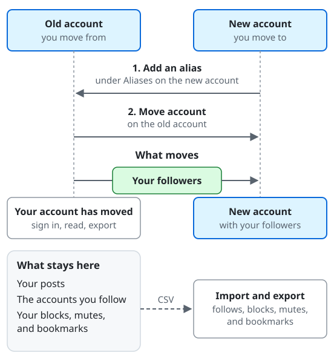

# Moving your account

You can move your account to another account, on the same server or on another one. Your followers follow the new
account, and the old account says that it moved. The same works in the other direction, when you move to this server
from another one.

## What moves and what stays

| Moves | Stays on the old account |
| --- | --- |
| Your followers | Your posts, the accounts you follow, your blocks, mutes, and bookmarks |

From the top of the diagram down:

1. **Add an alias.** On the new account, add the old account under "Aliases".
2. **Move account.** On the old account, choose "Move account" and name the new account.
3. **What moves.** Your followers follow the new account. The old account shows "Your account has moved": you can still sign in, read, and export your data there.
4. **What stays here.** Your posts, the accounts you follow, and your blocks, mutes, and bookmarks stay on the old account. Your posts do not move. Carry the rest yourself: export your follows, blocks, mutes, and bookmarks as CSV files with "Import and export" on the old account, and import them on the new one ([taking your follows with you](#taking-your-follows-with-you)).

## Moving from this account

1. On the new account, add this account as an alias: "Aliases", under "Account and data" in the settings, with "Add an alias". The move page shows this account's address, which you enter there.
2. On this account, open "Move account" under "Account and data" in the settings. Enter the handle of the new account (a handle such as `@name@example.com`, or the address of the account) and choose "Continue".
3. The client shows what moves and what stays. Enter your password to confirm (or, when you have no password, confirm with a passkey, or by signing in again at a linked provider) and choose "Move account".

After the move, the old account:

- Shows "Your account has moved". You can still sign in, read, export your data, and delete the account, but you cannot post, boost, react, follow, or vote.
- Is shown on its profile as moved to the new account.
- Cannot move again for 30 days.

"Cancel the move" brings the old account back: it can post and follow again, and other servers are told. Followers who
already moved stay with the new account.

## Moving to this account

Add the account you move from as an alias under "Aliases" in this account's settings ("Add an alias"). An alias alone
changes nothing; it only allows the other account to move its followers to you. You can have only a few aliases, and
"Remove" deletes one.

## Taking your follows with you

"Import and export", under "Account and data" in the settings, exports and imports CSV files in the format Mastodon uses.
You can export "Follows", "Blocked accounts", "Muted accounts", "Muted domains", and "Bookmarks", and import them on the
new account. "Merge" keeps what you have and adds what the file lists; "Overwrite" makes the list exactly what the file
lists. Accounts and posts on other servers are looked up in the background, which can take a while.

"Archive and deletion" prepares a ZIP archive of your posts, your profile, and your follows, blocks, mutes, and bookmarks.

## When an account you follow moves

You are notified ("... moved to another account"). When you can follow the new account, you follow it at once, or your
request awaits its approval. You do not follow it when you block it, when it blocks you, or when you muted its server;
the notification says which.
