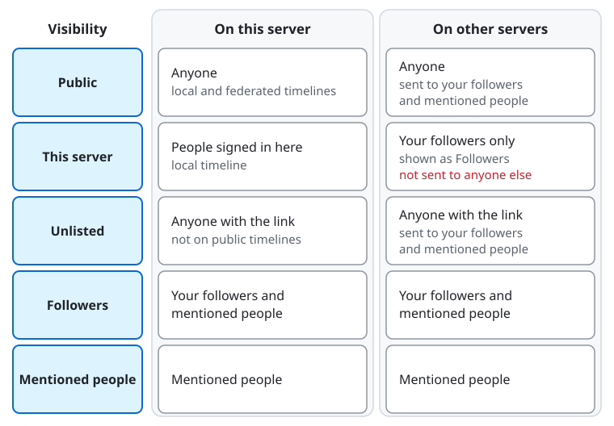

# Posting and choosing who sees a post

## Writing a post

Choose "Write a post" to open the form "New post". Type in "Your post" and choose "Post". The form shows how many
characters are left. Besides text you can:

- Attach images, video, or audio with "Add images, video, or audio". Describe each attachment for people who cannot see or hear it; some servers require a description for every attachment. Location and other metadata are removed from the files.
- "Add a poll", with options and a duration, and the choices "Allow choosing several options" and "Hide the votes until the poll ends".
- "Add a content warning". Readers see the warning first and choose "Show content".
- Choose "Hide the images until readers show them" to mark the media as sensitive.
- Set the language of the post, and "Who can quote" it: "Anyone", "Followers", or "Only you".
- Reply to a post ("Reply") or quote one ("Quote").

A post that could not be sent stays under "Posts being sent", where you can "Send again", "Edit", or "Discard" it.
A server can refuse a post after an automated review. When the refusal can be appealed, the post offers "Appeal".

## Who can see a post

The "Visibility" button of the form opens "Who can see this post?" for that post. The default for new posts is the
setting "Who sees your posts by default" under "Display, posting, and timelines" in the settings.

| Choice | Who can see it |
| --- | --- |
| Public | Anyone, here and on other servers. It is shown on the public timelines. |
| This server | People signed in to this server, and your followers on other servers. It is shown on this server's local timeline. |
| Unlisted | Anyone with the link, but it is not shown on the public timelines. |
| Followers | Only your followers and the people you mention. |
| Mentioned people | Only the people you mention. |

Row by row, on this server and then on other servers:

- **Public**: anyone, also people who are not signed in, and the post is shown on the local and federated timelines. On other servers anyone can read it, and it is sent to your followers and the people you mention.
- **This server**: the people signed in to this server, and the post is shown on the local timeline. Other servers receive it only for your followers there, who see it as a "Followers" post; it is not sent to anyone else.
- **Unlisted**: anyone with the link, but the post is not shown on the public timelines. On other servers too, anyone with the link can read it, and it is sent to your followers and the people you mention.
- **Followers**: your followers and the people you mention, on this server and on other servers.
- **Mentioned people**: only the people you mention, on this server and on other servers.

A block always wins: someone who blocks you, or whom you block, does not see your post whatever you chose.

### "This server"

A post set to "This server" stays on your server. People who are not signed in to it cannot read it, even with the
link, and it never appears on the federated timeline. Other servers receive it only for your followers there, and they
show it to those followers as a post for followers only.

- If you mention someone on another server who does not follow you, they do not receive the post, and your followers there see the mention as a plain link. The form warns you about this.
- Accounts of your server can boost a "This server" post, and the boost is shown only on this server.
- A reply to a "This server" post starts as "This server" too; you can change it.

### Other things to know

- You cannot change the visibility of a post after posting it. When you edit a post, the visibility and the post it replies to stay as they are.
- A moderator can limit how widely an account posts. The form then says "Your account can post at most as ..." and a wider choice is posted at the widest level allowed.
- Anyone who can see a public, "This server", or unlisted post can boost it. Only you can boost your own "Followers" posts, and only your followers see that boost. "Mentioned people" posts cannot be boosted.
- You can pin up to five of your posts to your profile with "Pin to profile". A "Mentioned people" post cannot be pinned.

## After posting

Under a post you find "Reply", "Boost", "Quote", "Favourite", and "Bookmark". The menu "More actions" has "Copy link",
and for your own posts "Edit", "Pin to profile", and "Delete". A post that was edited shows "Edited", and its earlier
versions are on its "Edit history" page. "Delete" removes the post for everyone, along with its boosts and favourites.

For a post by another person, the same menu offers to follow, mute, block, or report its author, and "Direct message".
Your bookmarks are listed on the "Bookmarks" page; only you see them.

When the server offers translation, or your browser can translate, "Translate" appears under posts in other languages.
If the server sends the text of posts to a translation service, the visibility picker tells you for which choices.
