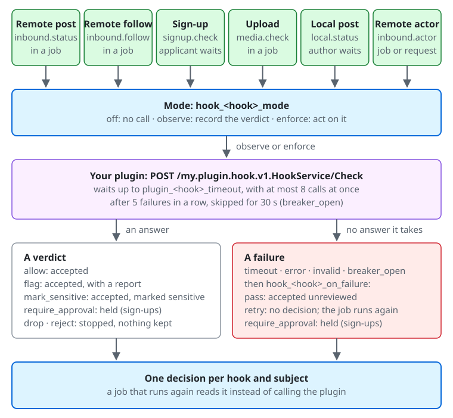

# Decision hooks

A decision hook asks a [plugin](plugins.md) of yours whether to accept something before the server accepts it. The plugin
answers with a verdict from a fixed list. It never rewrites anything and it takes no action on an account: the most it can do
is stop one post, follow, sign-up, or upload, or file a report for your moderators. People decide what happens to an account.

Nothing is reviewed by default. A server with no hook address makes no call and spends no time on them. This version keeps
the records, the modes, and the admin screens described here. Of the intake paths, posts from other servers ask
`inbound.status`, follows from other servers ask `inbound.follow`, sign-ups ask `signup.check`, uploads ask
`media.check`, and posts of local accounts ask `local.status`; the other hooks are not called yet.

From the top of the diagram down:

1. **What is reviewed, and who waits.** A post from another server (`inbound.status`), a follow from another server
   (`inbound.follow`), and an upload (`media.check`) are reviewed in a job. A sign-up (`signup.check`) is reviewed while
   the applicant waits, and a post of a local account (`local.status`) while its author waits.
2. **The mode**, `hook_<hook>_mode`: `off` makes no call, `observe` records the verdict and acts on nothing, and `enforce`
   acts on it ([Modes](#modes)).
3. **Your plugin** gets `POST /my.plugin.hook.v1.HookService/Check`. The server waits up to `plugin_<hook>_timeout`, makes
   at most 8 calls at once, and after 5 failures in a row skips the plugin for 30 seconds (`breaker_open`).
4. **A verdict**: `allow` accepts the subject, `flag` accepts it and files a report, `mark_sensitive` accepts it marked as
   sensitive, `require_approval` holds a sign-up, and `drop` and `reject` stop it and keep nothing (a sign-up's `reject` only with
   [`hook_signup_check_reject`](#sign-ups)). **A failure** is a `timeout`, an `error`, an `invalid` answer, or `breaker_open`, and an answer the hook does not take
   counts as one. When the hook enforces, `hook_<hook>_on_failure` decides: `pass` accepts the subject unreviewed, `retry`
   records no decision and runs the job again, and `require_approval` holds a sign-up
   ([When the plugin fails](#when-the-plugin-fails)).
5. **One decision per hook and subject** is recorded, and a job that runs again reads it instead of calling the plugin
   ([The decisions](#the-decisions)).

## The hooks

| Hook | What it reviews | What it can answer | When the plugin fails |
| --- | --- | --- | --- |
| `inbound.status` | Posts from other servers | `allow`, `drop`, `flag`, `mark_sensitive` | `pass` (default) or `retry` |
| `inbound.follow` | Follows from other servers | `allow`, `drop`, `flag` | `pass` (default) or `retry` |
| `signup.check` | Sign-ups, after the CAPTCHA and the block list | `allow`, `require_approval`, `reject` | `pass` (default) or `require_approval` |
| `media.check` | Uploaded media, before anyone can use them | `allow`, `mark_sensitive`, `flag`, `reject` | `pass` (default) or `retry` |
| `local.status` | Posts of local accounts, and their edits | `allow`, `flag`, `reject` | `pass` |

Set `plugin_<hook>_address` to give a hook a plugin, with a dot in the name becoming `_`
(`plugin_inbound_status_address`). [Plugins](plugins.md) covers the destination, its authentication, and how to test a
plugin with `my plugin test --kind inbound.status <address>`. The call is `POST /my.plugin.hook.v1.HookService/Check`.

What each answer does:

- `drop` stops the subject and stores nothing of it. A wrong `drop` silently hides a post from its followers too, so read
  what a hook would drop in `observe` before you enforce it.
- `flag` lets it through and files one report per decision. On `inbound.follow` the report is about the account that sent
  the follow, names no post, and is filed once the follow is recorded; its reporter, category, and comment are those of
  [a post's report](#what-inboundstatus-reviews).
- `mark_sensitive` lets it through and shows its attachments as sensitive until a moderator cancels the decision.
- `require_approval` holds the sign-up for approval.
- `reject` refuses it, with fixed text that shows nothing of the plugin's answer. On `signup.check` this also takes
  [the setting below](#sign-ups). On `media.check` it keeps nothing of the upload, the original included
  ([below](#what-mediacheck-reviews)). On `local.status` its author can [appeal](#local-posts).

An answer can carry a coded reason (`spam`, `harassment`, `sexual`, `violence`, `illegal`, `malware`, `other`) and a note of
up to 200 characters for your moderators. An answer the hook does not take counts as a failure.

## What `inbound.status` reviews

The server asks about each `Create` of a post and each `Update` of one that it would take in, before it stores anything. Every
revision is its own subject with its own decision.

- A post is asked about only when it is related to a local account: a local account follows its author, it names a local
  account, or it is in a thread with a local post. Whether a local account follows the author does not narrow it further:
  the plugin gets `any_local_follower` and can weigh it. A post only a relay brought in is never asked about, nor is an
  `Update` of a stored post that no longer relates to a local account: its revision is stored without a question.
- A direct post from an author no local account follows is not sent unless you turn on
  `hook_inbound_status_unfollowed_direct`. Posts of your local accounts are never sent, at any setting.
- Polls' votes, deletions, undos, likes, reactions, and boosts are never asked about, so stopping a plugin cannot stop a
  deletion from arriving. A thread fetch or a boost's fetch can still bring in the same post another way.

What each answer does to a post:

- `drop` on a `Create` stores nothing and creates no notification or timeline entry, and a redelivery is ignored as a
  duplicate. `drop` on an `Update` makes no revision and keeps the previous one. A dropped post is not stored, so an
  `Update` of it published within the last day is taken as a new post: the plugin is asked again about that revision, as about
  any other one, and its answer to the earlier `Create` does not carry over.
- `flag` files one report per decision, with your instance actor as the reporter, the reason's category (`spam` and
  `malware` as Spam, `illegal` as Legal, `harassment`, `sexual`, and `violence` as Violation, and anything else as Other), and
  the plugin's note as the comment. The report says that a review filed it. It is not forwarded to the author's server
  unless a moderator [forwards it](moderation.md#reports), and a forward never sends the note: only the text the moderator
  writes then. Resolving it notifies nobody. Each decision files its own
  report, so a wave of spam can fill the queue.
- `mark_sensitive` marks the post, not the revision: the mark stays on later revisions, whatever they are answered, until a
  moderator cancels the decision. It shows attachments as sensitive and leaves the text alone, so a post with no attachment
  looks no different, and other servers do not see it.

## What `media.check` reviews

The server asks about each file a local account uploads, for any use: an attachment, an avatar, a header, or a custom
emoji. It asks once, when the file is first processed and before it is ready, so nobody can use it while the plugin
decides. Using the same file for something else later reads the decision already made. Remote media is never asked about.

It sends the smallest image the server made of the file, without its metadata, and never the original: for a video or
audio file, the small image of its poster or embedded cover, or no image when there is none. With it go what the file
is for, whether it is an image, video, or audio, its size, how long it plays, and whether it moves. The alt text and
anything of the account or of a post are not sent. The message `MediaSubject` of the `HookService` protocol has the fields.

What each answer does to an upload:

- `reject` makes the processing fail, as for a file the server cannot read: the uploader sees that the file could not be
  processed, and a post cannot attach it. **The server keeps nothing of a rejected file.** It deletes the original once
  processing ends, whatever the answer, and a rejected file gets no processed version. If you must preserve such
  files, or report them to someone, your plugin has to do it when it answers: the server cannot give the file back.
  Cancelling a `reject` only changes its record.
- `mark_sensitive` marks the post that attaches the file, in the transaction that creates the post or the edit that adds
  the file, and the mark stays until a moderator cancels the decision, as for `inbound.status`. An avatar, a header, or an
  emoji has no post, so the decision is only recorded.
- `flag` files one report per decision, with your instance actor as the reporter. For an attachment it is filed with the
  post that attaches the file and points at that post; a file that is never posted files none. For an avatar, a header, or
  an emoji it is filed when the file is processed, about the account that uploaded it.

The processing job waits for the plugin for up to `plugin_media_check_timeout` (10 seconds by default). Adding a custom
emoji from another server or approving an emoji request processes the image while the moderator waits, so that wait
is theirs.

## Sign-ups

`signup.check` runs on sign-ups from the registration page and through a login provider, after the CAPTCHA and the
[sign-up block list](moderation.md), so a request either of them refuses never reaches the plugin. A sign-up with an
invite code never calls it. It sends the email address the applicant entered and the client's IP address; the account does
not exist yet, so the key of the subject is the ID the account would get, and an applicant who tries again is a new subject.

The answers act as the block list's do when the hook enforces:

- `require_approval` leaves the sign-up waiting under **Moderation** > **Registrations**, as a block with the same severity
  does, in every registration mode. Approve or reject it there: cancelling the decision does not change the registration.
- `reject` does nothing until you turn on `hook_signup_check_reject` (**Server settings** > **Federation** > **External review**, off by
  default). While it is off, a `reject` is recorded in `observe`, since it stops nothing, and the sign-up goes on. While it
  is on, the applicant sees the same fixed text as for a block ("This server cannot accept this sign-up."). No account is
  written, so cancelling such a decision only changes its record, and the applicant signs up again.

Applicants never see the reason or the note of a decision.

The applicant's request waits for the plugin for up to `plugin_signup_check_timeout` (2 seconds by default; keep it short, as
a person is waiting). The wait is not part of a database transaction. A sign-up that later fails, such as for a taken
username, keeps its decision until the retention removes it.

## Local posts

`local.status` reviews a post of an account on your server before the server creates it, and each edit of one before the
server stores it. The author waits for the plugin, so
the wait is short: `plugin_local_status_timeout` (1 second by default). A failure, a timeout, or an open breaker always lets the
post through (`pass` is its only failure behaviour), and the wait is not part of a database transaction.

What it sends and when:

- Only the posts of accounts younger than `hook_local_status_account_age_days` (**Server settings** > **Federation** >
  **External review**, 7 days by default; `0` sends the posts of every account). New accounts are where most spam comes from, and established
  accounts are not sent.
- Only `public`, `local`, and `unlisted` posts. `private` and `direct` posts are never sent.
- The text as the author typed it and as the server renders it, the content warning, the language, whether it is marked
  sensitive, the image descriptions, the poll options, the hashtags, how many accounts it mentions, the address the post would
  get, the post it replies to or quotes (by address only), the author's address and username, and when the account was
  created. No media is sent.
- The key of the subject is the ID the post would get. Sending a post again with the same `Idempotency-Key` returns the post
  that was created, without calling the plugin; a new attempt is a new subject.
- An edit is sent the same way, with the post as edited, to the same accounts: those inside
  `hook_local_status_account_age_days`. Its key is the post's ID, `#`, and the ID of the new revision, so each edit is a
  subject of its own.
- Starting a voice chat room posts its first post without this hook.

When it enforces, `reject` refuses the post and nothing is stored. The author sees fixed text ("This post was not published.")
and a way to appeal; never the reason or the note. `flag` lets the post through and files one report of it, against its
author.

On an edit, `reject` refuses that edit alone: the post stays as it was, and the author sees fixed text ("This edit was not
saved."). An edit cannot be appealed, since the post is still there for your moderators to act on as usual. `flag` stores the
edit and files a report of the post, and `allow` lets it through.

### Appeals

The author of a refused post can appeal it within `appeal_window_days` (the same window as for moderation actions), once per
decision. The appeal carries the text of the post, since the server stored nothing of it, and an optional comment for your
moderators. No plugin is called.

Your moderators (`manage_reports`) are notified of each new appeal (**Appeals of refused posts** in their notification
settings, which they can also get by email; the notification opens the appeal), and review appeals under **Moderation** >
**Automated reviews** > **Appeals of refused posts**. Each appeal opens on its own page, with the text the author sent:

- **Uphold** leaves the decision as it is, and goes in the audit log as `hook_appeal_upheld`.
- **Overturn** cancels the decision, which goes in the audit log as `hook_decision_overridden`, and stops sending the
  account's posts to `local.status`, in one transaction. The refused post is not restored: the author posts it again.

Either way the author is notified of the outcome, among the notices from the moderators, and the post form shows it under
the refusal. The notification and the form say only whether the decision stays or was cancelled, never the reason or the
note. A first-party client reads where an appeal stands with `GET /api/v1/hook_decisions/{id}/appeal`.

An account that an overturned appeal took out of the hook stays out of it until the account is deleted. If it is later taken
over, `local.status` no longer reviews it.

## Modes

Each hook has a mode, an [instance setting](instance-settings.md) (`hook_inbound_status_mode` and so on) you change under
**Server settings** > **Federation** > **External review**. Changes go in the audit log as `setting_changed`.

| Mode | What it does |
| --- | --- |
| `off` | Calls nothing. |
| `observe` | Records the verdict and acts on nothing. This is the default of every hook. |
| `enforce` | Acts on the verdict. |

A hook goes from `off` to `enforce` only through `observe`.

## When the plugin fails

A timeout, an error, and an invalid answer are recorded as outcomes of their own (`timeout`, `error`, `invalid`), never as
verdicts. After 5 failed calls in a row the server skips the plugin for 30 seconds and then tries one call, so an outage
costs each subject no wait; a skipped call is recorded as `breaker_open`. Each server process counts by itself.

What happens to the subject then depends on `hook_<hook>_on_failure`:

- `pass` lets it through unreviewed. Spam can get in during an outage, but nothing else stops. This is the default.
- `retry` fails the job, which runs again and calls the plugin again, and records no decision. Jobs from one actor run in
  order, so everything later from that actor waits meanwhile, deletions included, for up to about 4 hours and 15 minutes.
  After its last run the job becomes a [dead job](running.md#the-job-queue-and-failed-dead-jobs), which releases the others.
- `require_approval` holds the sign-up for a moderator.

For `media.check`, `pass` makes the file ready unreviewed. `retry` holds the upload as still processing until the plugin
answers or the job runs out of runs; the file is never ready meanwhile, and a dead job leaves it unprocessed, which the
cleanup of unattached uploads then deletes. No other job waits for it.

Each process makes at most 8 calls of a plugin at once, and a call that waits its turn past the hook's deadline counts as a
timeout. Waits show in `my.plugin.slot_wait` ([Running](running.md)). Keep `plugin_inbound_status_timeout` short: while a call
waits, later jobs from the same actor wait with it.

In `observe` a failure never holds anything up. Moderators get a notification once a day per hook when its calls keep failing.
The metrics are `my.hook.decisions`, `my.hook.failures`, and `my.hook.duration` ([Running](running.md)).

## The decisions

The server records one decision per hook and subject, so a job that runs again reads it and does not call the plugin again.
A decision holds the hook, the key of the subject, the mode, the outcome, the reason, the note, and how long the call took. It
holds no text of a post, no email address, and no IP address.

**Moderation** > **Automated reviews** (`manage_reports`) shows the counts and waits of the last 7 days, and what the hooks
stopped, would have stopped in `observe`, or could not check. Each decision opens on its own page with its reason, note, and
wait. Cancelling a decision, from the list or its page, goes in the audit log as `hook_decision_overridden`. A `reject` of `local.status` is not cancelled there: its author [appeals it](#appeals).

What cancelling does depends on the answer. A `mark_sensitive` loses its mark, and a mark from a moderation action on the same
post stays. A `flag` keeps its report, which you resolve as usual. A `drop` of `inbound.status` processes the received post
again without asking the plugin, for as long as the server keeps the activity it received (7 days); after that, the screen
says so and cancelling only records the cancellation.

Cancelling a `drop` of `inbound.follow` runs the follow again, without calling the plugin, for as long as the server keeps
the activity it received (7 days). After that the follow cannot come back and the cancellation only goes on record; the
other server has to send a new follow.

A follow only asks the hook when it would be recorded as a new follow or follow request. Taking a follow back (`Undo`) never
asks, and neither does a follow that the server refuses anyway: one that the federation mode refuses, one of a moved or
deactivated account, one of the instance actor, or one between accounts that block each other, which gets its rejection as
usual. A follow sent again for a follow or request that already exists does not ask either: the server answers it as usual,
and accepts it again when the follow is already accepted. A dropped follow gets no answer, so the other server keeps showing
it as requested. Sending the same activity again is ignored as a duplicate.

An automated effect goes in the audit log, with the system as the actor, only when it leaves state: `mark_sensitive`, a
filed `flag`, and `require_approval` (`hook_decision_applied`). `drop` and `reject` store nothing, so they stay in the
decisions alone.

The job `hook.purge_decisions` removes decisions after `hook_decisions_retention_days` days (default 90, at least 30). It keeps
those that a sensitive mark on an existing post rests on, those of an account under a
[retention hold](moderation.md#record-retention-and-holds), and each `reject` of a new post by `local.status` its author can
still appeal or whose appeal waits for review. A `reject` of an edit cannot be appealed, so it goes once the retention period
is over. An appeal goes with its decision. Deleting an account removes its decisions, its appeals, and
its exemption from `local.status`.

## What you tell your users

While a hook has a plugin and is not `off`, your information page (`/about`) states that an external review is in use, what
it covers, and what is sent to it. The server writes this from your settings, including the account age of
`hook_local_status_account_age_days` (or that the posts of every account go, at `0`) and whether
`hook_inbound_status_unfollowed_direct` sends the direct posts of authors nobody here follows.

## What is sent, and what it costs

Calls, their cost, and sent data grow with the volume the server receives, on `inbound.status` above all: every post in scope
is one call, and every revision another. Review what you send before you turn a hook on:

- `inbound.status` and `local.status` send the text of posts, and refuse plain TCP, on loopback too. `inbound.status` sends
  what the remote server sent: the text in each of its languages, the content warning, whether it is marked sensitive, when
  it was published, the post's address and URL, the address of the post it replies to, the addresses and descriptions of
  attachments (no media), poll options, hashtags, the author and the author's server, the visibility, and how many accounts
  the post names and how many of them are local. It also sends whether a local account follows the author
  (`any_local_follower`), which is data about your users. Followers-only (`private`) posts are sent like public ones, and
  direct posts as [above](#what-inboundstatus-reviews). It sends nothing of the post it replies to but its address.
  `local.status` sends the fields listed under [Local posts](#local-posts). The message `InboundStatus` of the `HookService` protocol has the fields.
- `signup.check` sends the email address and the IP address of each applicant, and refuses plain TCP.
- `inbound.follow` sends the two parties of a follow.
- `media.check` sends the smallest processed image of each upload, never the original, with what the file is for, its
  kind, size, and length. It may use plain TCP, as it sends no text: a processed image can still show a person.
