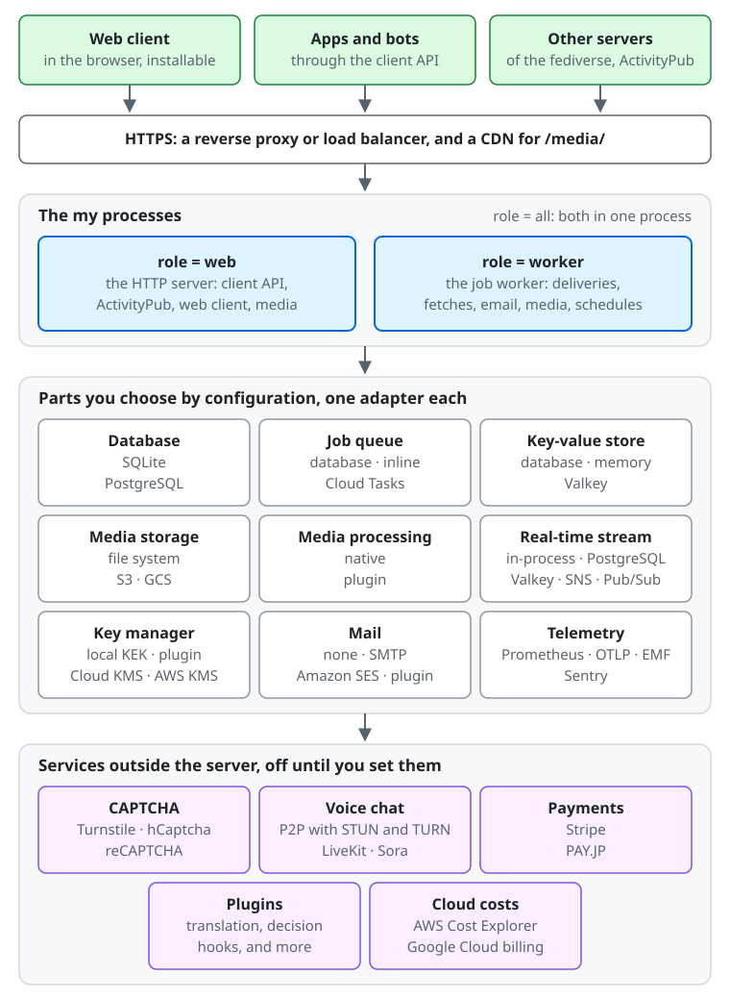
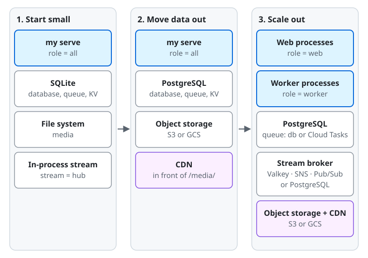

# Overview of a mycroblog server

The first page to read before running a server. mycroblog is a microblog that federates
with the rest of the fediverse over ActivityPub; `my` is its server software, one binary that holds the server, the job
worker, the web client, and the commands that look after them. This page shows what a server is made of, what you
choose by configuration, how a small server grows into a large one, and where to read next.

## What a server is made of

From the top of the diagram down:

- **Who connects.** People use the web client in their browser (it can be installed as an app), apps and bots use the
  client API, and other fediverse servers deliver and fetch posts over ActivityPub. All of them reach the server over
  HTTPS.
- **In front of the server.** `my` speaks plain HTTP, so a reverse proxy or load balancer terminates HTTPS in front of it.
  A CDN in front of the media files is optional.
- **The `my` processes.** Each process runs `my serve`, and its [`role`](../reference/configuration.md#role) says what it
  runs: `web` the HTTP server, `worker` the job worker, which delivers posts, fetches from other servers, sends email,
  processes media, and runs the periodic jobs, and `all`, the default, both in one process.
- **The parts you choose.** Each part in the middle of the diagram has one setting that picks its adapter, listed in
  [the next section](#parts-you-choose-by-configuration).
- **Services outside the server.** CAPTCHA, voice chat, payments, plugins, and the import of cloud costs each stay off
  until you set them, and the server then calls the service you name.

## Parts you choose by configuration

Every part is a setting of the [configuration reference](../reference/configuration.md), set in a TOML file or as an
environment variable (`MY_` and the key in capitals, such as `MY_DATABASE`). The first option of each list is the default.
Where a part keeps data, choose it before the first start: the data does not move by itself when the setting changes.

| Part | Setting | Options | Read next |
| --- | --- | --- | --- |
| Database | [`database`](../reference/configuration.md#database) | `sqlite` (a file), `postgres` (PostgreSQL and compatible services) | [Database](database.md), [backup](backup.md) |
| Job queue | [`queue`](../reference/configuration.md#queue) | `db` (a table in the database), `inline` (runs each job at once in the same process, for tests and development), `cloudtasks` (Google Cloud Tasks wakes the server for each job; needs PostgreSQL) | [The job queue](running.md#the-job-queue-and-failed-dead-jobs) |
| Key-value store, for caches and rate limits | [`kv`](../reference/configuration.md#kv) | `db` (a table in the database), `memory` (each process on its own), `valkey` (Valkey or another Redis-protocol server, shared by every process) | [`kv`](../reference/configuration.md#kv) |
| Media storage | [`blob`](../reference/configuration.md#blob) | `fs` (a directory), `s3` (Amazon S3, Cloudflare R2, MinIO, Garage, and other S3-compatible stores), `gcs` (Google Cloud Storage) | [Docker Compose files](running.md#docker-compose-files), [backing up media](backup.md#media-in-a-bucket) |
| Media processing | [`media_image`](../reference/configuration.md#media_image), [`media_video`](../reference/configuration.md#media_video), [`media_audio`](../reference/configuration.md#media_audio), one for each kind of file | `native` (in the server), `plugin` (a plugin of yours converts the files of that kind) | [Converting media](plugins.md#converting-media) |
| Real-time stream between processes | [`stream`](../reference/configuration.md#stream) | `hub` (inside one process), `postgres` (`LISTEN` / `NOTIFY`), `valkey`, `sns` (Amazon SNS and SQS), `pubsub` (Google Cloud Pub/Sub) | [`stream`](../reference/configuration.md#stream) |
| Key manager, which encrypts the accounts' private keys | [`key_manager`](../reference/configuration.md#key_manager) | `local` (a key-encryption key you keep), `gcpkms` (Google Cloud KMS), `awskms` (AWS KMS), `plugin` | [Managing the key](key-management.md) |
| Email | [`mail`](../reference/configuration.md#mail) | `none`, `smtp`, `ses` (Amazon SES), `plugin` | [Sending email](email.md) |
| CAPTCHA | [`captcha`](../reference/configuration.md#captcha) | `none`, `turnstile` (Cloudflare Turnstile), `hcaptcha`, `recaptcha` (Google reCAPTCHA v2) | [CAPTCHA](captcha.md) |
| Voice chat | [`voice`](../reference/configuration.md#voice) | `off`, `p2p` (browser to browser, with TURN from `voice_turn`: `none`, `coturn`, or `cloudflare`), `livekit`, `sora` | [Voice chat](voice.md) |
| Supporter payments | [`payments`](../reference/configuration.md#payments) | `none`, `stripe`, `payjp` (PAY.JP) | [Supporters](supporters.md), [Stripe](payments-stripe.md), [PAY.JP](payments-payjp.md) |
| Plugins | `plugin_<kind>_address` | none by default; one address for each kind: `translator`, `billing`, `mailer`, `media`, `key_manager`, and the decision hooks `inbound.status`, `local.status`, `inbound.follow`, `signup.check`, `media.check`, `inbound.actor`, `local.profile` | [Plugins](plugins.md), [decision hooks](decision-hooks.md) |
| Translation of posts | `translator_<provider>_*`, [`plugin_translator_address`](../reference/configuration.md#plugin_translator_address) | none (only the browser's own translation); `libretranslate`, `deepl`, `google` (Google Cloud Translation), `aws` (Amazon Translate), or a plugin of yours in front of the service you choose | [Translating posts](translation.md), [a translator plugin](plugins.md#translating-posts) |
| Full-text search of posts | [`search`](../reference/configuration.md#search) | `none`; or `elasticsearch`, `opensearch`, or `meilisearch` ([search engines](search-engines.md)) | [Full-text search](search.md) |
| CDN for media | [`media_origin`](../reference/configuration.md#media_origin) | unset (the server serves media from its own origin), or the origin of your CDN | [Serving media through a CDN](cdn.md) |
| Cloud costs | [`billing_sources`](../reference/configuration.md#billing_sources) | none, or any of `aws` (AWS Cost Explorer), `gcp` (Google Cloud's billing export or budget), `plugin` | [Importing cloud costs](billing-import.md) |
| Metrics | [`metrics_exporter`](../reference/configuration.md#metrics_exporter) | `none`, `prometheus`, `otlp` (OpenTelemetry), `emf` (CloudWatch) | [Metrics](running.md#metrics), [alerts](alerts.md) |
| Traces | [`traces_exporter`](../reference/configuration.md#traces_exporter) | `none`, `otlp` | [Traces](running.md#traces) |
| Error reports | [`errors_exporter`](../reference/configuration.md#errors_exporter) | `none` (the log line and the error groups only), `sentry` (Sentry, GlitchTip, Datadog), `otlp` | [Error reporting](error-reporting.md) |

The released binary and container image hold every adapter of the table. A binary you build yourself can leave the
ones you do not use out with [build tags](../reference/build-tags.md), and then refuses their settings at start.

`my config check` reports every problem of the configuration at once, before you start the server
([production checklist](production-checklist.md)).

## From a small server to a large one

1. **Start small.** One process with `role = all`, on SQLite, with media on the file system and the defaults for the
   rest: the queue and the key-value store in the database, and the real-time stream inside the process. The Docker
   Compose files in `deploy/docker` start this setup on one machine ([deploying with Docker Compose](deploy-docker-compose.md)).
   It suits a personal or small server. `stream = hub` reaches only the process it runs in, so this setup stays at one
   process.
2. **Move the data out.** PostgreSQL for the database, an S3-compatible bucket or Google Cloud Storage for the media,
   and a CDN in front of the media. The server is still one process, but it no longer depends on one disk, and the
   processes of the next step can share the data. Decide on this before the first start if you can: moving the data
   from SQLite and the file system later is a job of its own ([what to back up](backup.md#what-to-back-up) lists
   what has to move).
3. **Scale out.** Run processes with `role = web` for the requests and `role = worker` for the jobs, as many as each
   needs, and split the workers by job type ([splitting workers](running.md#splitting-workers-by-job-type)).
   With more than one process, the real-time stream needs a broker that reaches every process (`postgres`, `valkey`,
   `sns`, or `pubsub`), and the key-value store should be shared (`db` or `valkey`), since `memory` keeps the rate
   limits of each process apart. The job queue stays in
   PostgreSQL, or moves to Google Cloud Tasks ([Cloud Tasks](running.md#cloud-tasks)).

The [Cloud Run deployment](deploy-cloud-run.md) is an example of a setup between the second and the third step:
`role = all` on Cloud Run, PostgreSQL on Neon, media in Cloud Storage, Cloud Tasks for the jobs, and Pub/Sub for the
stream, with no instance running while nobody uses the server.

## Where to go next

Read the operator guides in this order:

1. **Get started:** [run the server](running.md) or [deploy it on Cloud Run](deploy-cloud-run.md), then go through the
   [production checklist](production-checklist.md) before you open it to users.
2. **Configure the instance:** its [settings](instance-settings.md), [registration](registration.md),
   [external login providers](login-providers.md), [email](email.md), [CAPTCHA](captcha.md), [the CDN](cdn.md),
   [link previews](link-previews.md), and [search engines and AI crawlers](crawlers.md).
3. **Turn on features:** [moderation](moderation.md), [relays](relays.md), [webhooks](webhooks.md),
   [plugins](plugins.md) and [decision hooks](decision-hooks.md), [voice chat](voice.md), [full-text search](search.md),
   [supporters](supporters.md) and their payments, and [importing cloud costs](billing-import.md).
4. **Run it day to day:** [monitoring](monitoring.md), [alerts](alerts.md), [error reporting](error-reporting.md),
   [maintenance](maintenance.md), [backup](backup.md), [the database](database.md),
   [the key-encryption key](key-management.md), and [administrators and roles](admin-cli.md).
5. **Legal and closing:** the [privacy policy](privacy-policy-template.md) and
   [record of processing](processing-record-template.md) templates, and [closing the service](service-closure.md).

The [configuration reference](../reference/configuration.md) lists every setting, and the [jobs reference](../reference/jobs.md)
every job the workers run.
