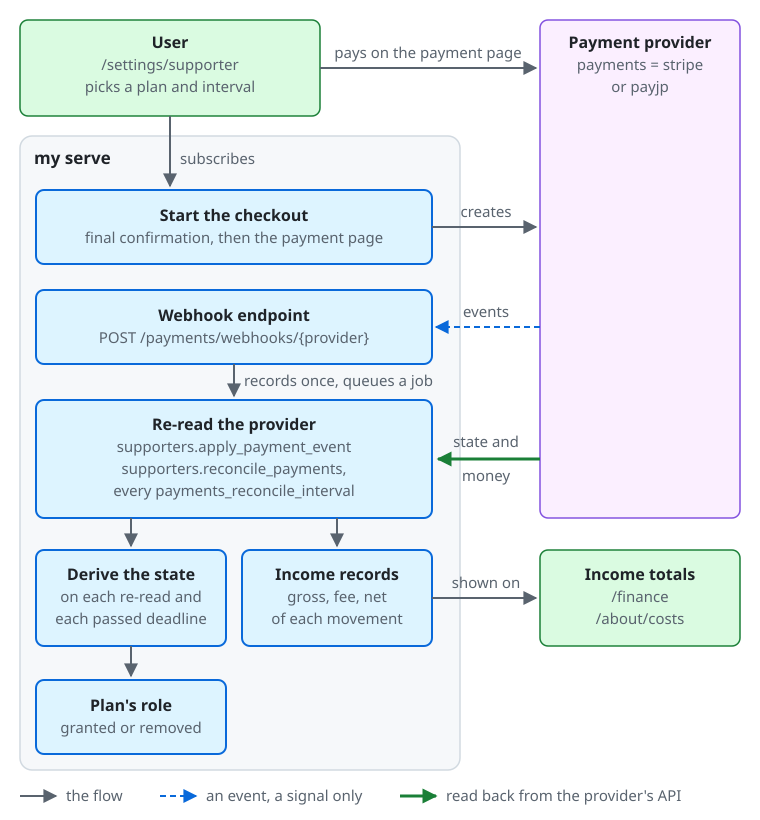
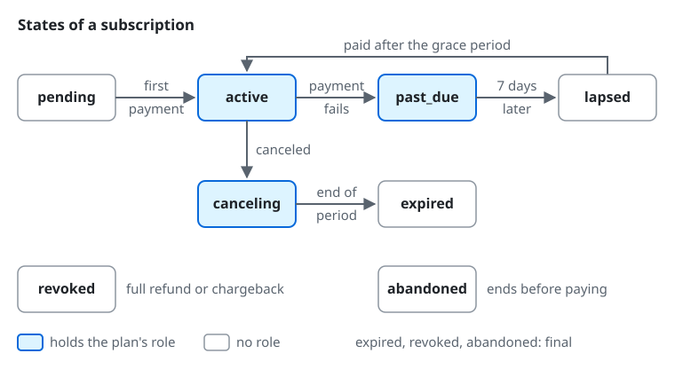

# Supporters (paid plans)

Only when an administrator enables it, local users can subscribe to a paid plan on the web and hold the role tied to the plan for as long as they keep paying. The program is off by default, and no plan or subscription entry point appears anywhere until it is enabled.
The deployment key `payments` is described in the [configuration reference](../reference/configuration.md#payments).

**mycroblog does not guarantee compliance with any law, including Japan's Act on Specified Commercial Transactions.** Operators must check the content of the disclosure, the final confirmation screen, and the handling of consumption tax and invoices against the laws of their own country (see "What operators must check" below).

## How a subscription works

From the top of the diagram down:

- **Subscribing.** The user picks a plan and an interval (month or year) at `/settings/supporter`. After the final confirmation, the server (`my serve`) creates the payment page at the provider set by `payments` (`stripe` or `payjp`), and the user pays on that page.
- **Events.** The provider sends its events to the webhook endpoint `POST /payments/webhooks/{provider}`, which records each event once and queues a job. An event is only a signal: the server never takes the state from its contents.
- **Reading back.** The job `supporters.apply_payment_event`, and the reconciliation `supporters.reconcile_payments` every `payments_reconcile_interval`, read the subscription and the money movements back from the provider's API. The reconciliation repairs any event that did not arrive.
- **The state and the role.** The server derives the state of the subscription from what it read and from each deadline that has passed (the 7-day grace period, for example), and grants or removes the plan's role with it.
- **Income.** The money movements become the income records (gross amount, fee, and net of each payment, refund, chargeback, and fee). Their totals are shown on the finance screen (`/finance`, to people with `view_finance`) and, as far as `income_visibility` allows, on `/about/costs` (see [instance-settings.md](instance-settings.md)).

The states of a subscription, as the administration and `my admin supporters subscriptions` show them:

- `pending`: started, not paid yet. No role. The first payment makes it `active`, and a subscription that ends before its first payment becomes `abandoned`.
- `active`: paid. It holds the plan's role, which each renewal keeps.
- `past_due`: a payment failed. It keeps the role for 7 days from the failure; a payment in that time makes it `active` again.
- `lapsed`: 7 days passed after the failure. The role is removed. A payment after that makes it `active` again, and the role comes back.
- `canceling`: canceled at the end of the period. It keeps the role until then, and becomes `expired`.
- `expired`, `revoked` (a full refund or a chargeback), and `abandoned` are final and hold no role.

## Enabling the program

1. Set the deployment key `payments` to your payment provider and pass the provider's keys and webhook secret. Provider-specific steps are in [payments-stripe.md](payments-stripe.md) and [payments-payjp.md](payments-payjp.md). The program cannot be enabled while the key is `none`.
2. Configure the server to send email (`mail` other than `none`). Only users with a confirmed email address can subscribe, so a server that sends no email cannot enable the program.
3. On the "Commerce disclosures" page of "Terms and policies" in the administration (`/admin/documents/commerce-disclosure`), write the commerce disclosure (for Japan, the notice required by the Act on Specified Commercial Transactions), the instance text `commerce_disclosure`, in Markdown. It is published at `/about/commerce`, and you can register that URL in the provider's dashboard.
   The program can be enabled with the text empty, but the administration shows a warning.
4. In "Roles" in the administration, create the role to tie to the plan. It must have no holders, only member permissions (group `member`), and a `position` lower than that of every staff role, `moderator` included.
   The member permissions are the benefits a plan can give: `create_custom_emojis` (requesting custom emoji), `view_finance` (reading the server's finances), `start_voice_rooms` (opening voice chat rooms while only permitted users may), and `create_invites` (inviting people while only permitted users may, within the limits of [member invites](registration.md#member-invites)).
   When the subscription ends, the role goes, and so do the benefits: the invites the supporter made stop working until they subscribe again.
5. In "Supporters" in the administration (permission `manage_supporters`), open the "Plans" page (`/admin/supporters/plans`) and choose "Create a plan". Set the name, description, monthly price, discount for yearly payment, monthly limit on custom emoji creation (it resets on the first day of each month, UTC; see [custom emoji](instance-settings.md#custom-emoji)), order, and visibility, and choose the role.
   The server creates the monthly and yearly prices at the provider (do not create prices in the provider's dashboard). Until the prices exist, the plan is "preparing" and accepts no subscriptions.
6. On the "Program" page of "Supporters" (`/admin/supporters`), check "Enable the supporter program" and choose "Save". The same form sets who may read the supporter list.

Once a plan exists, its role can no longer be granted or revoked by hand, and you change its permissions and position on the plan's page (choose the plan on the "Plans" page). A higher plan (a larger order) sits above the roles of the lower plans, has all of their permissions, and has an emoji limit at least as high as theirs.

## Setup at the provider

- **Deactivation**: A subscriber cannot deactivate their account while the subscription is live, including one set to end at the end of its period. The settings screen leads them to the subscription, so that no one is charged while hidden.
- **Retries (dunning)**: Seven days after a payment fails, the server removes the role (independently of the provider's retries). Set the provider's retry period to at least 7 days and make the final action "cancel". When the payment succeeds after the grace period, the role comes back.
- **Customer portal**: The portal is opened for payment methods and invoices. Turn off plan changes in the portal and allow only cancellation at the end of the period. Plan changes and cancellations are made on the server's own screens.
- **Refunds**: The server refunds only a payment that bought nothing: a second subscription of one payment, and a payment for a pending subscription that closed. The provider's guide ([Stripe](payments-stripe.md), [PAY.JP](payments-payjp.md)) describes both. Every other refund is the operator's, in the provider's dashboard. A full refund and a chargeback remove the role at once and cancel the provider's subscription at once. A partial refund does not remove the role. Winning a chargeback does not restore the role; the user subscribes again.

## What users see

- On the web, a user opens "Supporter plans" (`/settings/supporter`), picks a plan and a payment interval (month or year), goes through a final confirmation screen, and moves on to the provider's payment page. Card details never pass through this server. The payment page returns to this screen, which then reads the state of the subscription again.
  While subscribed, the user can change plans from the same screen (an upgrade and a switch from monthly to yearly apply once their prorated difference is paid, while a downgrade and a switch from yearly to monthly apply at the end of the period), cancel a scheduled change, cancel the subscription (the benefits last until the end of the period) and undo a cancellation, and open the customer portal for payment methods and invoices.
  When the payment of a change fails, or the card asks for authentication that the change cannot ask for, the plan stays and the user sees an error with the way to update the card. It does not start the grace period or send the failed-payment notification; a failed renewal still does.
- Only users of this server who have a confirmed email address and an account that is neither suspended nor scheduled for deletion can subscribe. A user can hold one plan at a time.
- `/about` shows a section with the public plans. In the Tauri app, the subscription screen, the plans section of `/about`, and the links to them do not appear. The benefits (badge, custom emoji, finance) work in the app too.

## Notifications to subscribers

Subscribers are told once about each of the following, by notification, Web Push, and email (to the primary address, in the user's language). A subscriber whose account is deactivated is told nothing, then or on coming back.

- Payment failure (`supporter_payment_failed`): when the subscription becomes past due (`past_due`). It gives the end of the grace period (in UTC in the email) and a link to the screen where the payment method can be fixed (`/settings/supporter`).
- End of the subscription (`supporter_subscription_ended`): when a subscription leaves a state with benefits because the grace period ran out, it expired, or it ended with a refund or a chargeback. The message states the reason. An end caused by deleting the account is not announced.
- Plan retirement (`supporter_plan_retired`): to the subscribers of a retired plan (except pending ones). It says the subscription will not renew.
- Announcement of the end of the service (`supporter_service_closure`): to the subscribers whose subscription was cancelled at the end of its period when the announcement began (except pending ones). It says the subscription will not renew. No new subscriptions are accepted during the announcement.

The text of Web Push and notifications does not lead to the payment screen. Only the web client puts a link to the subscription screen in a notification; the Tauri app does not. The links in emails open the web client in a browser.

## CLI

`my admin supporters` performs part of the operations of the administration (`my admin supporters -help`).

- `status`: whether the program is enabled, what it needs before it can be enabled (a provider, email), and the number of running subscriptions.
- `enable`, `disable`: enable and disable the program. Disabling is refused while any subscription is running.
- `plans`: the list of plans (retired ones included), with the number of preparing and retired plans and of subscriptions.
- `subscriptions`: the list of subscriptions (filter with `-plan` and `-state`). `cancel <subscription ID>` cancels a subscription at once (no refund, except a payment for a pending subscription, which bought nothing).

Enabling, disabling, and cancelling are written to the audit log as CLI operations. Creating, changing, and retiring plans is done in the administration or through the admin API.

## The list of members

- The instance setting `supporter_list_visibility` (on the "Supporters" screen; see [instance-settings.md](instance-settings.md)) chooses who can see the list of current subscribers (`/about/supporters`). With the default `off`, neither the list nor the link from `/about` appears.
- The list shows only the subscribers who chose to be listed on the "Badges and supporter list" page of their settings (nobody is listed by default). It shows the plan name and each person's avatar, display name, and handle, and never amounts, whether the payment is monthly or yearly, dates, or counts.
- A choice to be listed stays when the subscriber changes plans, and disappears when the subscription ends (the role is removed). Someone who subscribes again starts unlisted.
- The list page and its API always send `noindex, noarchive`, whatever the search-engine setting (`search_indexing`) says.

## Changing prices, hiding plans, and retiring plans

- When you change the monthly price or the discount, the new price applies to new subscriptions and plan changes. Existing subscribers renew at their original price. There is no operation to move existing subscribers to a new price. To move them, create a new plan and retire the old one.
- Hiding a plan stops new subscriptions and changes to that plan. Existing subscriptions continue.
- Retiring a plan cannot be undone. Its subscriptions are cancelled at the end of their period (pending ones close at once and their payment page stops taking payments, with any payment that still arrives refunded; and ones whose payment is late beyond the grace period are cancelled at once). When the last subscription ends, the role goes back to an ordinary role.

## Accounts and subscriptions

- Deleting an account and banning it (which schedules deletion) cancel its subscriptions at once, without a refund (a payment for a subscription still pending bought nothing, and is refunded). Reversing a ban does not restore the subscriptions.
- Suspending an account schedules cancellation at the end of the period. Lifting the suspension does not restore it automatically; the user cancels the cancellation before the end of the period or subscribes again.
- On the "Subscriptions" page of "Supporters" (`/admin/supporters/subscriptions`), an administrator can open one subscription and end it at once with "End now" (no refund, except a payment for a pending subscription, which bought nothing; it is written to the audit log).

## Disabling the program and changing providers

- The program cannot be disabled while any subscription is running (pending, active, scheduled to cancel, past due, or past the grace period). Retire every plan first and disable the program after the subscriptions have ended.
- To change providers, disable the program, change `payments`, and enable the program again with the new provider. Existing subscribers subscribe again. While the configured provider differs from the one the program was enabled with, the server refuses new subscriptions and changes, and the administration shows a warning.

## What operators must check (not yet verified)

mycroblog does not judge any of these. Check them against the laws of your country and the terms of your provider.

- The items that the commerce disclosure must contain (the seller's name, address, and phone number, the price, when and how to pay, when the service is provided, how to cancel, and so on) and how it must be published.
- That the final confirmation screen (Article 12-6 of the Act on Specified Commercial Transactions) shows the quantity, the price, the payment timing, the delivery timing, and the way to cancel and its effect, taking the provider's payment page and the confirmation screen of `my` together.
- The handling of consumption tax, and whether you issue qualified invoices.
